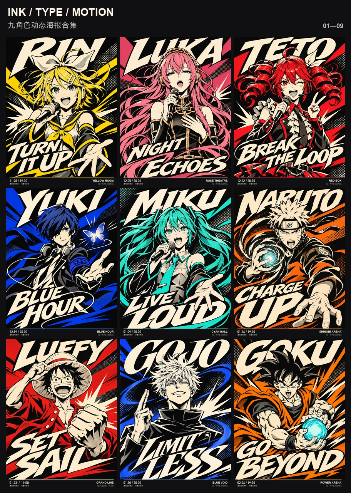

# GIF 工厂

**挑一种风格，给一张参考图，把角色、相片和想法做成循环 GIF。**

像素小人、人物与宠物、粘土吉祥物、光栅变画、漫画动态海报。
先看效果，再换成你自己的角色和主题；拿不准就先做一张。

**6 个分类 · 9 个 GIF 风格入口 · 每种都有案例和制作说明**

[浏览风格](styles/README.md) · [完整作品库](GALLERY.md) · [怎么使用](GUIDE.md) · [Skill](SKILL.md) · [下载项目](https://github.com/WoYun520/pixel-gif-sticker-pack/archive/refs/heads/main.zip)

## 精选：漫画印刷动态海报

人物、背景和大字一起设计。黑白打底，每个角色保留一种主色；从平静切到登场，字体也跟着展开，6 秒循环。

[▶ 播放九宫格 GIF](examples/dynamic-posters/p5-integrated/preview.gif) · [使用这个风格](styles/comic-fusion/STYLE.md) · [九张独立 GIF](examples/dynamic-posters/p5-integrated/README.md)

## 挑一种风格

点击预览进入制作说明。每种风格都有原尺寸案例；首页展示的是较小的动态预览。

### 像素与游戏

<table><tr>
<td width="50%" valign="top"> <strong><a href="styles/pixel-light/STYLE.md">像素轻动效</a></strong> 聊天表情包、头像小动画</td>
<td width="50%" valign="top"> <strong><a href="styles/pixel-actions/STYLE.md">像素完整动作</a></strong> 游戏感角色、动作表情包</td>
</tr></table>

### 插画与二次元

<table><tr>
<td width="50%" valign="top"> <strong><a href="styles/illustrated-actions/STYLE.md">插画角色动作</a></strong> 动漫角色、角色动作表情</td>
</tr></table>

### 真人与宠物

<table><tr>
<td width="50%" valign="top"> <strong><a href="styles/photo-people/STYLE.md">真人轻动效</a></strong> 人物反应、个人聊天表情</td>
<td width="50%" valign="top"> <strong><a href="styles/photo-pets/STYLE.md">宠物拟人</a></strong> 宠物聊天表情、趣味反应</td>
</tr></table>

### 材质与吉祥物

<table><tr>
<td width="50%" valign="top"> <strong><a href="styles/clay-mascot/STYLE.md">粘土吉祥物</a></strong> 虚构店铺、品牌 IP、产品搭档</td>
</tr></table>

### 卡片与变画

<table><tr>
<td width="50%" valign="top"> <strong><a href="styles/lenticular/STYLE.md">双状态光栅卡</a></strong> 收藏卡、人物双身份、产品两配色</td>
</tr></table>

### 海报与文字

<table><tr>
<td width="50%" valign="top"> <strong><a href="styles/type-linked/STYLE.md">人物与字体联动</a></strong> 演出预告、人物宣传、换装展示</td>
<td width="50%" valign="top"> <strong><a href="styles/comic-fusion/STYLE.md">漫画印刷整体融合</a></strong> 角色宣传、活动主视觉、演出海报</td>
</tr></table>

## 怎么用

在能生成图片、运行脚本的 Codex 里安装：

> 帮我安装 GIF 工厂：https://github.com/WoYun520/pixel-gif-sticker-pack

然后给参考图、选风格，说想做什么：

> 使用 $pixel-gif-sticker-pack，按“漫画印刷整体融合”风格，做一张我这个角色的动态宣传海报。人物和字一起变化，6 秒循环，先给一张看看。

也可以说“像素完整动作，每个角色 5 张”或“保留这张照片，做轻动效”。已经认可的小样会继续沿用。GIF 工厂的调用名暂时保留 `$pixel-gif-sticker-pack`，已有用法不变。

[详细使用指南](GUIDE.md) · [不知道选哪种？看风格索引](styles/README.md)

## 完整作品库

这里是制作方法的入口，完整系列另放作品库：**242 张已有聊天示例＋2 张重做待确认试样、9 张光栅卡、10 张动态海报**，以及品牌短片案例。每个系列默认折叠，100 张鲸鱼娘和像素小秘书也保留，点击对应窗口展开。

[打开完整作品库](GALLERY.md) · [鲸鱼娘与聊天表情包](GALLERY.md#表情包展厅) · [光栅卡](GALLERY.md#电子光栅卡展厅) · [动态海报](GALLERY.md#动态海报展厅)

## 扩展应用：吉祥物品牌短片

让吉祥物动手、递出产品、触发纸片机关，再把产品送进包装。这是从 GIF 角色素材延伸出来的视频方向，交付成片和能继续修改的工程，单独分类。

[看面包店短片与工程](examples/brand-films/manman-bakery/README.md) · [品牌短片制作流程](references/brand-film.md)

## 制作说明

外观、动作和用途分别选择：像素可以做轻动效，也可以做完整动作；光栅是变画方法，漫画印刷是设计语言。风格入口把可用组合整理给你，不表示所有素材和动作都已验证。

每次交付核对实际 GIF、数量、循环时长和画面；“高清”“帧数够了”不能替代人物稳定与审美检查。已认可、待确认和弃用的版本分开保留。

## 开源许可

制作脚本与 Skill 文档采用 [MIT](LICENSE)。动态海报的角色与参考设计语言不随代码转授商业权利，见[案例说明](examples/dynamic-posters/p5-integrated/README.md)。电子光栅卡中的角色 IP、网络照片与他人插画不随代码一并授予 MIT 权利，出处及使用边界见[案例来源说明](examples/lenticular-cards/README.md)。

第三方配乐和字体按各自许可使用；面包店案例的来源与署名见 [CREDITS](examples/brand-films/manman-bakery/CREDITS.md)。
