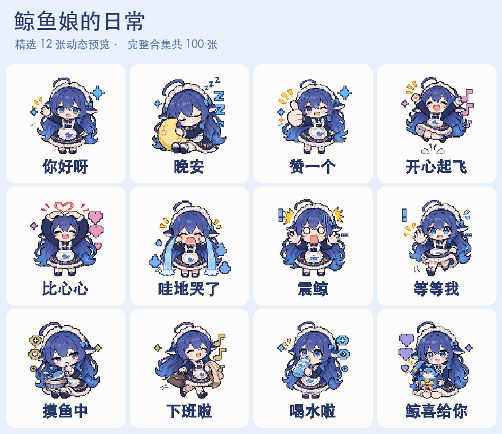

# GIF 表情包工作室

给 Codex 一张角色图，让它帮你做一套会动的表情包。

比如你有一个卡通人物或吉祥物，想让它说“收到”“好耶”“抱抱”“我好困”。这套工具会帮你设计表情和动作、加上文字，再把做好的动图打包给你。

做完能拿到一张张单独的 GIF、一个打包下载的文件，以及一段能直接播放的预览视频。GIF 的背景可以是透明的，方便放进聊天里。

## 表情包展厅

两套角色，共 **200 张 GIF**。每张是 320 × 320 像素，大约两秒循环一次，点击任意动图可查看原尺寸。

**大肥鱼默认展示；点击「像素小秘书」窗口，就能展开另一套 100 张。**

[下载整个项目，包含两套共 200 张动图](https://github.com/WoYun520/pixel-gif-sticker-pack/archive/refs/heads/main.zip)

### 大肥鱼 · 精选动态预览



<details open>
<summary><strong>🐋 大肥鱼（鲸鱼娘） · 100 张 · 默认展开</strong></summary>

蓝发鲸鱼娘的日常聊天表情，分为日常问候、开心撒娇、情绪反应、聊天回应、工作学习、生活状态和鲸喜祝福。

### 日常问候 · 16 张

| | | | |
| --- | --- | --- | --- |
| <a href="examples/whale-maid/01-greetings/001.gif"></a><br>001 你好呀 | <a href="examples/whale-maid/01-greetings/002.gif"></a><br>002 早安 | <a href="examples/whale-maid/01-greetings/003.gif"></a><br>003 晚安 | <a href="examples/whale-maid/01-greetings/004.gif"></a><br>004 请多关照 |
| <a href="examples/whale-maid/01-greetings/005.gif"></a><br>005 欢迎呀 | <a href="examples/whale-maid/01-greetings/006.gif"></a><br>006 谢谢你 | <a href="examples/whale-maid/01-greetings/007.gif"></a><br>007 对不起 | <a href="examples/whale-maid/01-greetings/008.gif"></a><br>008 好哒 |
| <a href="examples/whale-maid/01-greetings/009.gif"></a><br>009 赞一个 | <a href="examples/whale-maid/01-greetings/010.gif"></a><br>010 拜拜啦 | <a href="examples/whale-maid/01-greetings/011.gif"></a><br>011 有点害羞 | <a href="examples/whale-maid/01-greetings/012.gif"></a><br>012 乖巧等候 |
| <a href="examples/whale-maid/01-greetings/013.gif"></a><br>013 在吗在吗 | <a href="examples/whale-maid/01-greetings/014.gif"></a><br>014 探个头 | <a href="examples/whale-maid/01-greetings/015.gif"></a><br>015 是我呀 | <a href="examples/whale-maid/01-greetings/016.gif"></a><br>016 为你服务 |

### 开心撒娇 · 16 张

| | | | |
| --- | --- | --- | --- |
| <a href="examples/whale-maid/02-joy-and-affection/017.gif"></a><br>017 哈哈哈哈 | <a href="examples/whale-maid/02-joy-and-affection/018.gif"></a><br>018 耶 | <a href="examples/whale-maid/02-joy-and-affection/019.gif"></a><br>019 开心起飞 | <a href="examples/whale-maid/02-joy-and-affection/020.gif"></a><br>020 好耶 |
| <a href="examples/whale-maid/02-joy-and-affection/021.gif"></a><br>021 得意一下 | <a href="examples/whale-maid/02-joy-and-affection/022.gif"></a><br>022 啵一个 | <a href="examples/whale-maid/02-joy-and-affection/023.gif"></a><br>023 害羞了 | <a href="examples/whale-maid/02-joy-and-affection/024.gif"></a><br>024 抱抱你 |
| <a href="examples/whale-maid/02-joy-and-affection/025.gif"></a><br>025 比心心 | <a href="examples/whale-maid/02-joy-and-affection/026.gif"></a><br>026 拜托拜托 | <a href="examples/whale-maid/02-joy-and-affection/027.gif"></a><br>027 略略略 | <a href="examples/whale-maid/02-joy-and-affection/028.gif"></a><br>028 偷笑一下 |
| <a href="examples/whale-maid/02-joy-and-affection/029.gif"></a><br>029 贴贴 | <a href="examples/whale-maid/02-joy-and-affection/030.gif"></a><br>030 转个圈圈 | <a href="examples/whale-maid/02-joy-and-affection/031.gif"></a><br>031 撒花 | <a href="examples/whale-maid/02-joy-and-affection/032.gif"></a><br>032 送你礼物 |

### 情绪反应 · 16 张

| | | | |
| --- | --- | --- | --- |
| <a href="examples/whale-maid/03-emotions/033.gif"></a><br>033 哇地哭了 | <a href="examples/whale-maid/03-emotions/034.gif"></a><br>034 委屈巴巴 | <a href="examples/whale-maid/03-emotions/035.gif"></a><br>035 气鼓鼓 | <a href="examples/whale-maid/03-emotions/036.gif"></a><br>036 生气了 |
| <a href="examples/whale-maid/03-emotions/037.gif"></a><br>037 自闭一会 | <a href="examples/whale-maid/03-emotions/038.gif"></a><br>038 震鲸 | <a href="examples/whale-maid/03-emotions/039.gif"></a><br>039 怕怕 | <a href="examples/whale-maid/03-emotions/040.gif"></a><br>040 我不理解 |
| <a href="examples/whale-maid/03-emotions/041.gif"></a><br>041 尴尬一笑 | <a href="examples/whale-maid/03-emotions/042.gif"></a><br>042 无语住了 | <a href="examples/whale-maid/03-emotions/043.gif"></a><br>043 我躺平了 | <a href="examples/whale-maid/03-emotions/044.gif"></a><br>044 啊啊啊 |
| <a href="examples/whale-maid/03-emotions/045.gif"></a><br>045 失落了 | <a href="examples/whale-maid/03-emotions/046.gif"></a><br>046 哼 | <a href="examples/whale-maid/03-emotions/047.gif"></a><br>047 慌得一批 | <a href="examples/whale-maid/03-emotions/048.gif"></a><br>048 我很怀疑 |

### 聊天回应 · 16 张

| | | | |
| --- | --- | --- | --- |
| <a href="examples/whale-maid/04-replies/049.gif"></a><br>049 收到 | <a href="examples/whale-maid/04-replies/050.gif"></a><br>050 听着呢 | <a href="examples/whale-maid/04-replies/051.gif"></a><br>051 安排 | <a href="examples/whale-maid/04-replies/052.gif"></a><br>052 等等我 |
| <a href="examples/whale-maid/04-replies/053.gif"></a><br>053 马上来 | <a href="examples/whale-maid/04-replies/054.gif"></a><br>054 我先溜了 | <a href="examples/whale-maid/04-replies/055.gif"></a><br>055 让我看看 | <a href="examples/whale-maid/04-replies/056.gif"></a><br>056 真的假的 |
| <a href="examples/whale-maid/04-replies/057.gif"></a><br>057 我懂了 | <a href="examples/whale-maid/04-replies/058.gif"></a><br>058 不可以 | <a href="examples/whale-maid/04-replies/059.gif"></a><br>059 可以哒 | <a href="examples/whale-maid/04-replies/060.gif"></a><br>060 请继续 |
| <a href="examples/whale-maid/04-replies/061.gif"></a><br>061 听我说 | <a href="examples/whale-maid/04-replies/062.gif"></a><br>062 交给我 | <a href="examples/whale-maid/04-replies/063.gif"></a><br>063 救救我 | <a href="examples/whale-maid/04-replies/064.gif"></a><br>064 保密哦 |

### 工作学习 · 16 张

| | | | |
| --- | --- | --- | --- |
| <a href="examples/whale-maid/05-work-and-study/065.gif"></a><br>065 开工啦 | <a href="examples/whale-maid/05-work-and-study/066.gif"></a><br>066 努力中 | <a href="examples/whale-maid/05-work-and-study/067.gif"></a><br>067 头秃了 | <a href="examples/whale-maid/05-work-and-study/068.gif"></a><br>068 摸鱼中 |
| <a href="examples/whale-maid/05-work-and-study/069.gif"></a><br>069 加油鸭 | <a href="examples/whale-maid/05-work-and-study/070.gif"></a><br>070 搞定 | <a href="examples/whale-maid/05-work-and-study/071.gif"></a><br>071 下班啦 | <a href="examples/whale-maid/05-work-and-study/072.gif"></a><br>072 开会中 |
| <a href="examples/whale-maid/05-work-and-study/073.gif"></a><br>073 学习中 | <a href="examples/whale-maid/05-work-and-study/074.gif"></a><br>074 记下来 | <a href="examples/whale-maid/05-work-and-study/075.gif"></a><br>075 有灵感了 | <a href="examples/whale-maid/05-work-and-study/076.gif"></a><br>076 再试一次 |
| <a href="examples/whale-maid/05-work-and-study/077.gif"></a><br>077 卡住了 | <a href="examples/whale-maid/05-work-and-study/078.gif"></a><br>078 求夸夸 | <a href="examples/whale-maid/05-work-and-study/079.gif"></a><br>079 冲鸭 | <a href="examples/whale-maid/05-work-and-study/080.gif"></a><br>080 发工资啦 |

### 生活状态 · 16 张

| | | | |
| --- | --- | --- | --- |
| <a href="examples/whale-maid/06-daily-life/081.gif"></a><br>081 饭饭呢 | <a href="examples/whale-maid/06-daily-life/082.gif"></a><br>082 好好吃 | <a href="examples/whale-maid/06-daily-life/083.gif"></a><br>083 喝水啦 | <a href="examples/whale-maid/06-daily-life/084.gif"></a><br>084 来杯茶 |
| <a href="examples/whale-maid/06-daily-life/085.gif"></a><br>085 好困啊 | <a href="examples/whale-maid/06-daily-life/086.gif"></a><br>086 起不来 | <a href="examples/whale-maid/06-daily-life/087.gif"></a><br>087 洗香香 | <a href="examples/whale-maid/06-daily-life/088.gif"></a><br>088 出门啦 |
| <a href="examples/whale-maid/06-daily-life/089.gif"></a><br>089 下雨了 | <a href="examples/whale-maid/06-daily-life/090.gif"></a><br>090 好热啊 | <a href="examples/whale-maid/06-daily-life/091.gif"></a><br>091 好冷啊 | <a href="examples/whale-maid/06-daily-life/092.gif"></a><br>092 运动一下 |
| <a href="examples/whale-maid/06-daily-life/093.gif"></a><br>093 买买买 | <a href="examples/whale-maid/06-daily-life/094.gif"></a><br>094 追剧中 | <a href="examples/whale-maid/06-daily-life/095.gif"></a><br>095 没电了 | <a href="examples/whale-maid/06-daily-life/096.gif"></a><br>096 满血复活 |

### 鲸喜祝福 · 4 张

| | | | |
| --- | --- | --- | --- |
| <a href="examples/whale-maid/07-celebrations/097.gif"></a><br>097 生日快乐 | <a href="examples/whale-maid/07-celebrations/098.gif"></a><br>098 好运来 | <a href="examples/whale-maid/07-celebrations/099.gif"></a><br>099 周末快乐 | <a href="examples/whale-maid/07-celebrations/100.gif"></a><br>100 鲸喜给你 |

</details>

<details>
<summary><strong>🪟 像素小秘书 × 奶油麻薯 · 100 张 · 点击窗口展开</strong></summary>

原有的像素小秘书系列，按回消息、情绪、陪伴、工作、吃喝玩乐、生活状态和节日彩蛋分类展示。

### 回消息 · 16 张

| | | | |
| --- | --- | --- | --- |
| <a href="examples/01-replies/001.gif"></a><br>001 马上来 | <a href="examples/01-replies/002.gif"></a><br>002 看到了 | <a href="examples/01-replies/003.gif"></a><br>003 没问题 | <a href="examples/01-replies/004.gif"></a><br>004 我在 |
| <a href="examples/01-replies/005.gif"></a><br>005 等我一下 | <a href="examples/01-replies/006.gif"></a><br>006 稍等 | <a href="examples/01-replies/007.gif"></a><br>007 继续说 | <a href="examples/01-replies/008.gif"></a><br>008 懂了 |
| <a href="examples/01-replies/009.gif"></a><br>009 同意 | <a href="examples/01-replies/010.gif"></a><br>010 不行 | <a href="examples/01-replies/011.gif"></a><br>011 随你 | <a href="examples/01-replies/012.gif"></a><br>012 安排上 |
| <a href="examples/01-replies/013.gif"></a><br>013 记住了 | <a href="examples/01-replies/014.gif"></a><br>014 确实 | <a href="examples/01-replies/015.gif"></a><br>015 先这样 | <a href="examples/01-replies/016.gif"></a><br>016 回头聊 |

### 情绪 · 16 张

| | | | |
| --- | --- | --- | --- |
| <a href="examples/02-emotions/017.gif"></a><br>017 笑出声 | <a href="examples/02-emotions/018.gif"></a><br>018 憋不住 | <a href="examples/02-emotions/019.gif"></a><br>019 无语 | <a href="examples/02-emotions/020.gif"></a><br>020 好家伙 |
| <a href="examples/02-emotions/021.gif"></a><br>021 慌了 | <a href="examples/02-emotions/022.gif"></a><br>022 委屈巴巴 | <a href="examples/02-emotions/023.gif"></a><br>023 破防了 | <a href="examples/02-emotions/024.gif"></a><br>024 别惹我 |
| <a href="examples/02-emotions/025.gif"></a><br>025 气鼓鼓 | <a href="examples/02-emotions/026.gif"></a><br>026 社死了 | <a href="examples/02-emotions/027.gif"></a><br>027 我酸了 | <a href="examples/02-emotions/028.gif"></a><br>028 不敢看 |
| <a href="examples/02-emotions/029.gif"></a><br>029 眼前一黑 | <a href="examples/02-emotions/030.gif"></a><br>030 一点点心动 | <a href="examples/02-emotions/031.gif"></a><br>031 我裂开了 | <a href="examples/02-emotions/032.gif"></a><br>032 燃起来了 |

### 陪伴 · 16 张

| | | | |
| --- | --- | --- | --- |
| <a href="examples/03-companionship/033.gif"></a><br>033 贴贴 | <a href="examples/03-companionship/034.gif"></a><br>034 摸摸头 | <a href="examples/03-companionship/035.gif"></a><br>035 递纸巾 | <a href="examples/03-companionship/036.gif"></a><br>036 别怕 |
| <a href="examples/03-companionship/037.gif"></a><br>037 辛苦了 | <a href="examples/03-companionship/038.gif"></a><br>038 给你花 | <a href="examples/03-companionship/039.gif"></a><br>039 给你糖 | <a href="examples/03-companionship/040.gif"></a><br>040 想你了 |
| <a href="examples/03-companionship/041.gif"></a><br>041 接住你 | <a href="examples/03-companionship/042.gif"></a><br>042 给你靠 | <a href="examples/03-companionship/043.gif"></a><br>043 我听着 | <a href="examples/03-companionship/044.gif"></a><br>044 亲一口 |
| <a href="examples/03-companionship/045.gif"></a><br>045 和好吧 | <a href="examples/03-companionship/046.gif"></a><br>046 一起加油 | <a href="examples/03-companionship/047.gif"></a><br>047 祝你好运 | <a href="examples/03-companionship/048.gif"></a><br>048 抱紧点 |

### 工作 · 16 张

| | | | |
| --- | --- | --- | --- |
| <a href="examples/04-work/049.gif"></a><br>049 开工 | <a href="examples/04-work/050.gif"></a><br>050 开会中 | <a href="examples/04-work/051.gif"></a><br>051 在写了 | <a href="examples/04-work/052.gif"></a><br>052 改改改 |
| <a href="examples/04-work/053.gif"></a><br>053 来活了 | <a href="examples/04-work/054.gif"></a><br>054 查一下 | <a href="examples/04-work/055.gif"></a><br>055 交作业 | <a href="examples/04-work/056.gif"></a><br>056 审核中 |
| <a href="examples/04-work/057.gif"></a><br>057 已保存 | <a href="examples/04-work/058.gif"></a><br>058 找不到 | <a href="examples/04-work/059.gif"></a><br>059 打个卡 | <a href="examples/04-work/060.gif"></a><br>060 会议结束 |
| <a href="examples/04-work/061.gif"></a><br>061 要下班 | <a href="examples/04-work/062.gif"></a><br>062 加班中 | <a href="examples/04-work/063.gif"></a><br>063 请个假 | <a href="examples/04-work/064.gif"></a><br>064 明天再说 |

### 吃喝玩乐 · 16 张

| | | | |
| --- | --- | --- | --- |
| <a href="examples/05-food-and-fun/065.gif"></a><br>065 干饭啦 | <a href="examples/05-food-and-fun/066.gif"></a><br>066 喝奶茶 | <a href="examples/05-food-and-fun/067.gif"></a><br>067 来一口 | <a href="examples/05-food-and-fun/068.gif"></a><br>068 太好吃了 |
| <a href="examples/05-food-and-fun/069.gif"></a><br>069 辣到了 | <a href="examples/05-food-and-fun/070.gif"></a><br>070 喝水喝水 | <a href="examples/05-food-and-fun/071.gif"></a><br>071 碰个杯 | <a href="examples/05-food-and-fun/072.gif"></a><br>072 走走走 |
| <a href="examples/05-food-and-fun/073.gif"></a><br>073 看电影 | <a href="examples/05-food-and-fun/074.gif"></a><br>074 打游戏 | <a href="examples/05-food-and-fun/075.gif"></a><br>075 拍一张 | <a href="examples/05-food-and-fun/076.gif"></a><br>076 逛街去 |
| <a href="examples/05-food-and-fun/077.gif"></a><br>077 收到礼物 | <a href="examples/05-food-and-fun/078.gif"></a><br>078 生日快乐 | <a href="examples/05-food-and-fun/079.gif"></a><br>079 音乐时间 | <a href="examples/05-food-and-fun/080.gif"></a><br>080 拆开看看 |

### 生活状态 · 16 张

| | | | |
| --- | --- | --- | --- |
| <a href="examples/06-daily-life/081.gif"></a><br>081 早呀 | <a href="examples/06-daily-life/082.gif"></a><br>082 醒醒 | <a href="examples/06-daily-life/083.gif"></a><br>083 充会电 | <a href="examples/06-daily-life/084.gif"></a><br>084 我好困 |
| <a href="examples/06-daily-life/085.gif"></a><br>085 休息一下 | <a href="examples/06-daily-life/086.gif"></a><br>086 外面下雨 | <a href="examples/06-daily-life/087.gif"></a><br>087 好冷 | <a href="examples/06-daily-life/088.gif"></a><br>088 好热 |
| <a href="examples/06-daily-life/089.gif"></a><br>089 到家了 | <a href="examples/06-daily-life/090.gif"></a><br>090 没信号 | <a href="examples/06-daily-life/091.gif"></a><br>091 电量不足 | <a href="examples/06-daily-life/092.gif"></a><br>092 我出门啦 |
| <a href="examples/06-daily-life/093.gif"></a><br>093 运动一下 | <a href="examples/06-daily-life/094.gif"></a><br>094 整理一下 | <a href="examples/06-daily-life/095.gif"></a><br>095 一起睡 | <a href="examples/06-daily-life/096.gif"></a><br>096 做个好梦 |

### 节日彩蛋 · 4 张

| | | | |
| --- | --- | --- | --- |
| <a href="examples/07-celebrations/097.gif"></a><br>097 新年快乐 | <a href="examples/07-celebrations/098.gif"></a><br>098 中秋快乐 | <a href="examples/07-celebrations/099.gif"></a><br>099 节日快乐 | <a href="examples/07-celebrations/100.gif"></a><br>100 周末快乐 |

</details>

## 怎么用

你需要在能生成图片、运行脚本的 Codex 中使用它。

**第一步，把下面这句话发给 Codex，安装工具。**

> 帮我安装这个表情包 Skill：https://github.com/WoYun520/pixel-gif-sticker-pack

Skill 可以理解成给 Codex 用的一份做事指南。装好以后，它就知道怎么按这套流程做表情包了。

**第二步，发一张角色图片，再说清楚想做什么。**

比如，把下面这句话和图片一起发给 Codex。

> 使用 $pixel-gif-sticker-pack，拿这张图里的角色做 16 张中文表情包。我要“收到”“好耶”“抱抱”“晚安”这类日常聊天用语，动作活泼一点，帮我打包好，再给我一个能播放的预览。

你也可以直接说“做一套上班用的”“做 30 张安慰人的”或“用我自己的台词”。数量、文字和风格都可以提。

生成时会用到图片生成工具。第一次运行如果缺少做动图的工具，可以让 Codex 帮你检查和安装。

<details>
<summary>想自己运行脚本？点这里看操作方法</summary>

需要 Python 3 和 Pillow。如果还想生成预览视频，需要安装带有 libx264 的 FFmpeg。

先准备一张透明背景的大图，把各个姿势分别放在大小相同的格子里，再按[清单格式](references/manifest.md)填好每张的文字、位置和动作。

```sh
python3 -m pip install Pillow
python3 scripts/export_pack.py manifest.json build --font /path/to/font.ttf --preview
```

`--font` 后面填你电脑上支持中文的字体文件路径。做好的文件会放在 `build` 文件夹。

默认动效包括位移、摇摆、挤压和像素小特效。脚本会检查数量、重复图片、动画是否变化、背景是否透明、有没有裁掉内容，以及压缩包能否打开。

</details>

## 开源许可

[MIT](LICENSE)
