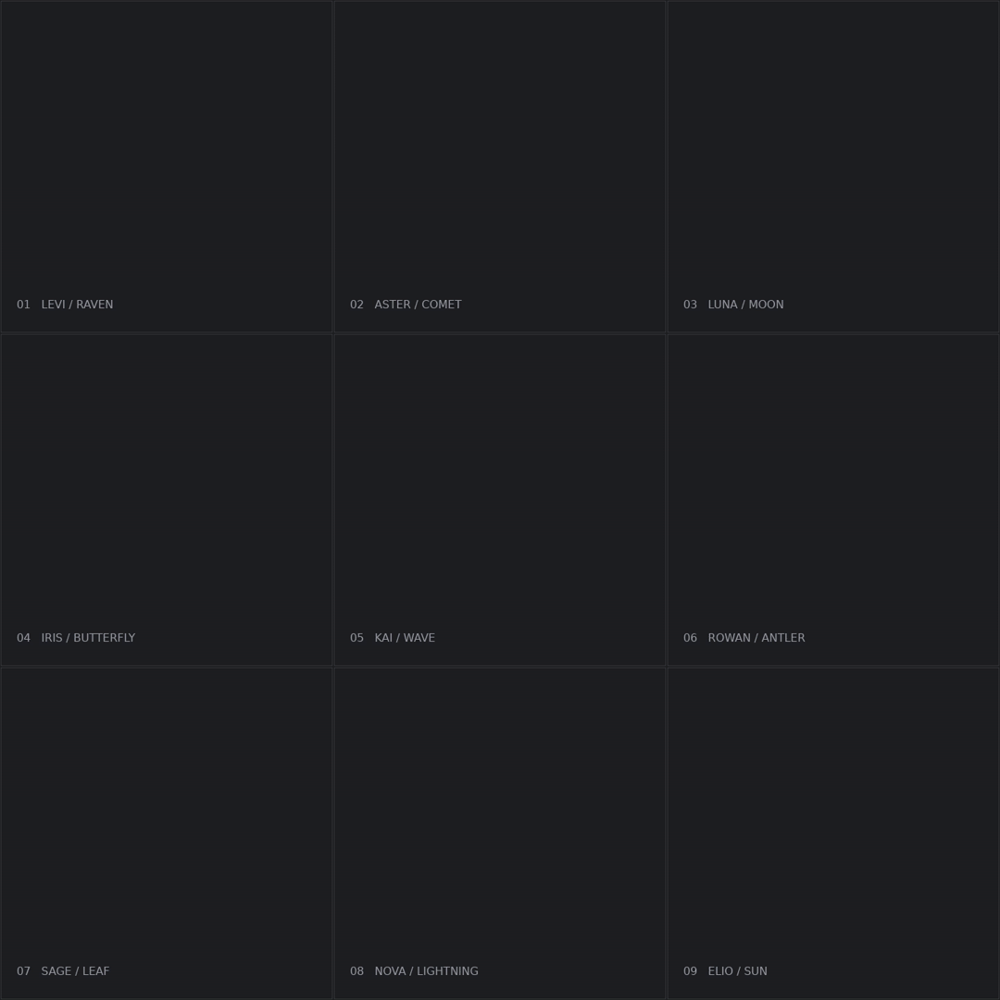

# 动态艺术签名 · 九款样例

[制作方法](../../skills/dynamic-art-signature/SKILL.md) · [风格入口](../../styles/dynamic-signatures/STYLE.md)

| 名字 | GIF | MP4 | 原图与参数 |
| --- | --- | --- | --- |
| Levi | [播放](../../skills/dynamic-art-signature/assets/media/Levi.gif) | [视频](../../skills/dynamic-art-signature/assets/media/Levi.mp4) | [原图](../../skills/dynamic-art-signature/assets/examples/Levi.png) · [JSON](../../skills/dynamic-art-signature/assets/examples/Levi.json) |
| Aster | [播放](../../skills/dynamic-art-signature/assets/media/Aster.gif) | [视频](../../skills/dynamic-art-signature/assets/media/Aster.mp4) | [原图](../../skills/dynamic-art-signature/assets/examples/Aster.png) · [JSON](../../skills/dynamic-art-signature/assets/examples/Aster.json) |
| Luna | [播放](../../skills/dynamic-art-signature/assets/media/Luna.gif) | [视频](../../skills/dynamic-art-signature/assets/media/Luna.mp4) | [原图](../../skills/dynamic-art-signature/assets/examples/Luna.png) · [JSON](../../skills/dynamic-art-signature/assets/examples/Luna.json) |
| Iris | [播放](../../skills/dynamic-art-signature/assets/media/Iris.gif) | [视频](../../skills/dynamic-art-signature/assets/media/Iris.mp4) | [原图](../../skills/dynamic-art-signature/assets/examples/Iris.png) · [JSON](../../skills/dynamic-art-signature/assets/examples/Iris.json) |
| Kai | [播放](../../skills/dynamic-art-signature/assets/media/Kai.gif) | [视频](../../skills/dynamic-art-signature/assets/media/Kai.mp4) | [原图](../../skills/dynamic-art-signature/assets/examples/Kai.png) · [JSON](../../skills/dynamic-art-signature/assets/examples/Kai.json) |
| Rowan | [播放](../../skills/dynamic-art-signature/assets/media/Rowan.gif) | [视频](../../skills/dynamic-art-signature/assets/media/Rowan.mp4) | [原图](../../skills/dynamic-art-signature/assets/examples/Rowan.png) · [JSON](../../skills/dynamic-art-signature/assets/examples/Rowan.json) |
| Sage | [播放](../../skills/dynamic-art-signature/assets/media/Sage.gif) | [视频](../../skills/dynamic-art-signature/assets/media/Sage.mp4) | [原图](../../skills/dynamic-art-signature/assets/examples/Sage.png) · [JSON](../../skills/dynamic-art-signature/assets/examples/Sage.json) |
| Nova | [播放](../../skills/dynamic-art-signature/assets/media/Nova.gif) | [视频](../../skills/dynamic-art-signature/assets/media/Nova.mp4) | [原图](../../skills/dynamic-art-signature/assets/examples/Nova.png) · [JSON](../../skills/dynamic-art-signature/assets/examples/Nova.json) |
| Elio | [播放](../../skills/dynamic-art-signature/assets/media/Elio.gif) | [视频](../../skills/dynamic-art-signature/assets/media/Elio.mp4) | [原图](../../skills/dynamic-art-signature/assets/examples/Elio.png) · [JSON](../../skills/dynamic-art-signature/assets/examples/Elio.json) |

两笔分离、约一秒停顿、无底印、无轻震、无回弹，末端减速。Levi 与 Aster 是迭代基准；七款扩展已完成技术检查，未据此推断逐款用户认可。原图为原创生成设计，未包含第三方参考截图。参数使用相对路径，需在安装模块内运行随附脚本。

