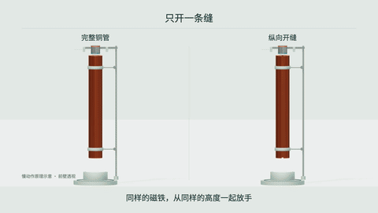

# 同屏实验：铜管与磁铁

两枚相同磁铁从相同高度同时释放。左侧铜管完整，右侧有贯通纵缝；先看下落差异，再用前壁透视、固定环带、感应电流、受力与能量图解释原因。

这是「vibe 知识大赏」第四种内置风格的完整案例，由本项目独立编写装置、模型、镜头与渲染，没有调用 lemo-opuscar Skill，也不依赖其风格文档或运行时。同屏对照是通用表达方法，不宣称独占该手法。

<a href="film.mp4"></a>

[79秒完整视频](film.mp4) · [封面](cover.png) · [字幕](captions.srt) · [铜管5秒小样](look-test.mp4) · [吸管5秒小样](straw-look-test.mp4) · [三维画面源码](source/) · [条件与模型](model.json) · [规格与哈希](media.json) · [来源](CREDITS.md) · [Skill流程](../../../skills/paper-mechanism-explainer/references/same-screen-experiments.md)

## 实际交付

完整片1920×1080、24fps、79秒，共1896帧；Clipchamp `Yunjie Dragon HD Flash Latest` 中文旁白，含25条字幕、原创轻拨弦背景和释放/落垫拟音。没有个人水印。网页GIF是重新裁切、缩小的静音循环预览；三个MP4保持本地已交付文件的原始字节，不把本次公开打包说成新一轮影片渲染。

铜管和吸管五秒片用于观察方向，不代表两者都有完整讲解。本例公开的是铜管完整片，物理运动均为有范围说明的原理模型。

## 镜头怎样讲原理

1. 同屏同步释放，先建立快慢差异。
2. 看铜管截面，辨认整圈回路与真实纵缝。
3. 从铜材与磁铁进入问题，再透视跟随运动磁铁。
4. 固定观察管壁上的一圈，展示穿过它的磁场变化与感应电流。
5. 涡流对应向上电磁阻力；同时保留向下重力，磁铁仍在下落。
6. 回到完整与开缝回路，补充局部涡流仍可能存在。
7. 在统一模型里展示势能、动能与铜管内能，再回到同屏完成下落。

字幕与场景读取同一[实际旁白时轴](source/timeline.json)。前壁透视只改变可见性，完整铜管的闭合条件保留；截面是放大讲解，并非在下落实验里又把铜管横向切断。

## 查看和复作源码

`source/` 提供本例自己的三维画面源码、统一状态模型、时轴与本地预览服务；它不是通用物理求解器，也不捆绑配音或渲染环境。

```bash
cd source
npm install
node serve.mjs
```

打开服务打印的本地地址。`window.READY` 为真后，`window.render(t)` 按绝对秒数定位，`window.frameJPEG()` 返回纯画面，`window.cover()` 生成封面。每秒导出24帧、共79秒即可得到本例画面序列。浏览器自动化使用当前环境允许的工具；不依赖某个固定浏览器或旧任务会话。

Three.js固定为0.170.0。公开源码改用可用的中文系统字体栈，不附本机字体；跨系统重渲的字形可能不同。正式成片采用Noto Sans CJK SC，授权见[CREDITS](CREDITS.md)。源码包不含依赖目录、原始配音、缓存、账号或机器绝对路径。新配音使用[narration.txt](narration.txt)，按用户当前选择和授权走[配音流程](../../../skills/paper-mechanism-explainer/references/clipchamp-voiceover.md)；更换声音或语速后重新对齐时轴。

## 原理与验收范围

本例采用位置相关线性阻尼，不用实验数据拟合具体落时；切缝后的阻尼保留非零。场线、电流、力箭头和局部涡流是讲解图形，不是可见发光物或完整电磁有限元结果。能量段只计算软垫接触前的过程，不把碰撞损失算作铜管发热。资料见[FACTS](FACTS.md)。

本地完整片已检查1896帧、完整音视频解码、字幕文本和时序、两边初态与下落顺序、相关能量守恒和逆序定位。旁白核对过微软网页的原稿与声线，另用本机ASR辅助检查连续性和时序；这些检查不替代人耳对自然度的判断。此次公开整理另核对媒体哈希、参考图、源码载入与链接。
