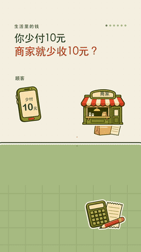

# 优惠券到底谁买单？

彩色贴纸风的方法样片。用手机、小店、平台电脑、商品袋和结算单，追踪一笔订单的付款与优惠承担。奶油纸底上的同一组物件持续操作，资金沿路径到达后再计入商家收款。

[完整MP4](film.mp4) · [封面](cover.jpg) · [字幕](captions.srt) · [金额模型](finance-model.json) · [规格与哈希](media.json) · [素材来源](CREDITS.md) · [独立 Skill](../../../skills/paper-mechanism-explainer/SKILL.md)

成片1080×1920、30fps、50.4秒、1512帧，含中文男声与配乐，无个人水印。GIF为三个片段的缩小静音节选，不是完整讲解。

## 一笔订单，三种假设

商品金额30元，优惠10元，顾客实付20元。以下是三种互斥的讲解条件，切换情形时重新计算，不把三笔资金累加：

| 情形 | 商家让利 | 平台补贴 | 商家未扣费收款 |
| --- | --- | --- | --- |
| 商家承担 | 10元 | 0元 | 20元 |
| 平台承担 | 0元 | 10元 | 30元 |
| 共同承担 | 4元 | 6元 | 26元 |

让利表示商家少收，不是再给顾客一笔现金。收款由顾客付款与条件成立时的平台补贴构成；省略佣金、运费、退款和其他费用，收款不等于利润。4∶6只是本片设定，不代表任何平台的固定比例或接口规则。

## 镜头作用

| 时间 | 画面与作用 |
| --- | --- |
| 0–5.5秒 | 手机出现10元券，提出“少付10元，商家就少收10元吗” |
| 5.5–14.367秒 | 建立30元订单、10元优惠与顾客20元付款，说明费用省略项 |
| 14.367–22.567秒 | 商家让利10元，商家收20元；解释少收的含义 |
| 22.567–28.5秒 | 平台补10元，路径到达后商家收款变成30元 |
| 28.5–39.4秒 | 商家让利4元，平台补6元，结算为26元 |
| 39.4–50.4秒 | 回到活动规则与结算单，区分收款和利润 |

## 依据和检查范围

[微信支付商户订单查询文档](https://pay.wechatpay.cn/doc/v3/merchant/4012791900)区分订单金额、用户实付、优惠与出资字段，本片借此确认这些金额应分开表达，不把演示模型当成该接口的实际返回。更多来源及各自适用范围见[CREDITS](CREDITS.md)。

原工程做过金额、现金来源、正反顺序状态、手机尺寸、路径到达和实际导出帧检查。本次整理复查媒体规格、完整解码、字幕范围与公开文件；技术检测不替代人耳逐段试听。影片沿用原版旁白，没有新生成或更换声线。

本目录提供媒体、字幕和模型，未附完整渲染工程、原生贴纸素材、字体文件或单独音轨。新题目按Skill重建可编辑场景与状态模型，核对自己的规则和素材许可。
