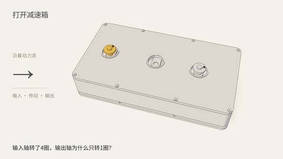

# 齿轮减速原理：四圈，怎么变成一圈

**本片实际使用了 [Lemo-Opuscar by Lemomo（LemoLab）](https://github.com/lemomo-ai/lemo-opuscar) 的 `lemo-opuscar` Skill。** Codex 调用该 Skill 的分色机械图解风格，复用了齿形生成、描边代码及材质、剖面渲染方法；齿轮箱布局、旁白、镜头、传动时序与声音编排为本期定制。

[76.67秒完整视频](film.mp4) · [5秒效果小样](look-test.mp4) · [封面](cover.jpg) · [字幕](captions.srt) · [模型参数](model.json) · [时序](timeline.json) · [原理资料](FACTS.md) · [规格与哈希](media.json) · [来源和许可](CREDITS.md)

成片1920×1080、24fps、76.666667秒、1840帧，配音为 Clipchamp 云杰 HD，含程序合成的轻配乐及机械音效，无个人水印。5秒小样先验证剖面、材质与联动效果，随后制作完整讲解；网页GIF是完整片的静音节选。

## 谁提供了什么

| 部分 | 来源与范围 |
| --- | --- |
| 制作 Skill 与风格 | 使用 Lemomo 的 lemo-opuscar Skill，按其分色机械图解规范制作 |
| 几何和渲染基础 | 上游 `gears.js` 的渐开线齿形、`film-outline.js` 的描边代码，以及适配后的材质和剖面渲染方法 |
| 本期定制 | 两级齿轮箱布局、讲解稿、镜头、运动时序、字幕及声音编排 |
| 配音 | 微软 Clipchamp：`Yunjie Dragon HD Flash Latest`，默认音调、1倍速 |
| 成片合成 | Three.js / WebGL 渲染，Whisper 辅助转写，FFmpeg 混音与合成 |

完整出处和制作时使用的上游代码版本在[CREDITS](CREDITS.md)。本仓库提供外部 Skill 的调用入口和公开案例，所需 `lemo-opuscar` Skill 及运行时另行安装，见[调用说明](../../../skills/paper-mechanism-explainer/references/lemo-cutaway.md)。

## 这只减速箱怎样工作

第一对20齿带40齿，转速减半。40齿大轮与18齿小轮刚性共轴，同速转动；18齿再带36齿，又减半。减速比按输入转速/输出转速定义：`(40/20) × (36/18) = 4`。所有零件的角度从同一个输入轴时钟推导。

理想稳态传动中，忽略损耗，输出速度为输入的四分之一，对应输出扭矩为输入的4倍；真实装置有损耗。本片是运动学教学装置，未进行材料、接触应力或负载仿真，模型参数不代表某款成品。

## 制作流程

1. 选定 Lemo 分色机械图解，用5秒小样确认实际效果。
2. 核对原理，编写本期旁白、镜头和统一传动模型。
3. 扩展齿轮箱工程，加入外壳剖面、镜头、转角示意和共轴观察。
4. 通过 Clipchamp 网页生成并下载云杰 HD 旁白；原始配音约63.65秒。
5. 根据真实语音时间安排字幕，在数圈段延长观察停顿，成片约76.67秒。
6. 从主轴运动导出机械点击时点，合成轻配乐，混音并导出。
7. 检查齿形、中心距、相位、共轴、盖板路径、文字、字幕范围及实际成片解码。

公开目录提供影片、封面、预览、字幕、原稿、模型、时序和检查摘要，供观察与复作；未打包完整渲染工程、上游 Skill、上游风格文档、字体二进制或单独音轨。新题目按已安装的外部 Skill 建立自己的可编辑工程。

## 本期检查范围

两对精确齿廓各采样1201个代表性相位，未发现边界交叉；全片18401个运动采样检查相位不漂移。单级演示的输入角增量为1圈、从动轮半圈；整机演示输入4圈、输出1圈。实际MP4完整解码通过，未检测到黑帧区间。

云杰声线在 Clipchamp 界面确认，原始旁白经独立转写和不区分声调的读音完整性核对；这是自动检查范围，不等同于人耳自然度验收。视频与音频检测摘要见[media.json](media.json)。
