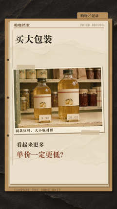

# 大包装一定更划算吗？

复古档案记录的风格试作。用档案夹、暖色商品照片、账纸、红笔和核对章，依次提出问题、记下价格、统一单位、比较差额。照片与数字分层，价格和容量由可编辑模型提供。

[完整MP4](film.mp4) · [封面](cover.jpg) · [字幕](captions.srt) · [比较模型](model.json) · [规格与哈希](media.json) · [素材来源](CREDITS.md) · [独立 Skill](../../../skills/paper-mechanism-explainer/SKILL.md)

成片1080×1920、30fps、22.166667秒、665帧，含中文男声与配乐，无个人水印。GIF是三个片段的缩小静音节选。

## 比较条件

假设同款饮料，没有额外优惠、费用或押金：

| 规格 | 总价 | 每100 mL |
| --- | --- | --- |
| 小瓶450 mL | 9.90元 | 2.20元 |
| 大瓶750 mL | 18.00元 | 2.40元 |

本例大瓶单价高0.20元／100 mL，结论仅适用于这组条件，不能推广成“大包装总是更贵”。价格和商品均为演示设定，不是实时商店报价。图片中的瓶子比例不作为容量测量依据。

## 四页档案

| 时间 | 画面与作用 |
| --- | --- |
| 0–3.233秒 | 文件夹和货架照片提出问题 |
| 3.233–10.567秒 | 同款大小瓶分别记下容量与总价 |
| 10.567–15.8秒 | 统一到每100 mL，算出2.20元与2.40元 |
| 15.8–22.167秒 | 红笔核对0.20元差额，回到“先把单位对齐” |

## 依据和检查范围

比较方法参考[NIST Unit Pricing Guide（2025）](https://nvlpubs.nist.gov/nistpubs/SpecialPublications/1181e2025/NIST.SP.1181e2025.html)与康涅狄格州消费者保护部门的[Saving Money with Unit Pricing](https://portal.ct.gov/dcp/common-elements/publications/saving-money-with-unit-pricing)。本片介绍单位价格比较，不将这些材料称为本地法律。

原工程用整数分核对价格、容量、单位价格与差额，做过手机尺寸、切点、实际导出帧及声音技术检测。本次整理复查媒体规格、完整解码、字幕范围和公开文件；技术检测不替代人耳逐段试听。沿用已有旁白和画面，没有重新生成视频。

暖色摄影为虚构商品的合成插图，不是历史照片或真实档案；没有人物或三维人偶。本目录提供媒体、字幕和模型，不包含完整渲染工程、照片原稿、字体或单独音轨。新题目应重建自己的模型，并复查资料和素材许可。
