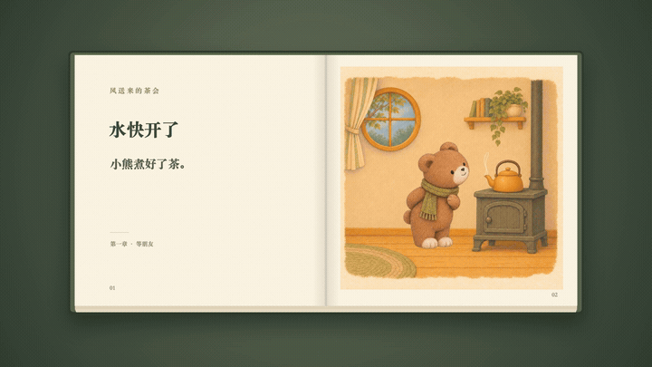

# 风送来的茶会 · 紧凑动态绘本

[返回首页](../../../README.md) · [风格说明](../../../styles/compact-storybook/STYLE.md) · [完整 Skill](../../../skills/compact-storybook/SKILL.md)

小熊备好三只杯子，请女孩把邀请折成纸鸟。狐狸收到信，带一片秋天来做客，最后大家把这一天夹进故事书。

上面是第一章的循环网页预览；正式成片里的动作单次完成，不倒放、不返回起点。

[观看 / 下载完整视频](https://raw.githubusercontent.com/WoYun520/gif-factory/main/examples/storybooks/tea-party/film.mp4) · [四章分段下载](chapters.zip) · [12页独立动作下载](pages.zip)

完整视频 **41.5秒、1920×1080、实际6fps、无声**。12页每页3秒，11次翻页各0.5秒。每页固定画面，动作结束后保留短暂结果。四章各10秒，独立页面各3秒，不带书框。

## 四个章节

| 章节 | 内容 | 视频 |
| --- | --- | --- |
| 等朋友 | 煮茶、摆杯、托付邀请 | [第一章](chapters/01.mp4) |
| 让风送信 | 折纸、放飞、接住纸鸟 | [第二章](chapters/02.mp4) |
| 带一片秋天 | 读信、拾叶、到小屋 | [第三章](chapters/03.mp4) |
| 把今天留下 | 迎接、喝茶、夹叶合书 | [第四章](chapters/04.mp4) |

## 12页动作

| 页 | 动作 | 页 | 动作 |
| --- | --- | --- | --- |
| 01 | [水快开了](pages/01.mp4) | 07 | [原来是邀请](pages/07.mp4) |
| 02 | [三只杯子](pages/02.mp4) | 08 | [带一片秋天](pages/08.mp4) |
| 03 | [帮我送封信](pages/03.mp4) | 09 | [前面的暖光](pages/09.mp4) |
| 04 | [折一只纸鸟](pages/04.mp4) | 10 | [终于等到你](pages/10.mp4) |
| 05 | [跟着风走](pages/05.mp4) | 11 | [一起吹一吹](pages/11.mp4) |
| 06 | [落在鼻尖前](pages/06.mp4) | 12 | [把今天留下](pages/12.mp4) |

## 方法与检查

角色参考参与图像生成；透明关键姿态与固定背景逐帧组合，纸鸟使用轨迹与手心锚点衔接，翻页单独制作。没有使用连续生成视频或插帧。

已核对实际导出帧率、时长、帧数，检查首中末帧及道具交接；修正过纸鸟落点和杯子桌面位置。用户已认可完整紧凑版。规格记录见 [verification.json](verification.json)，规格检查不代表所有新故事都能自动稳定。

本目录发布成片、分段及预览。可复用的制作规则和检查脚本在独立 Skill 中；此处不包含系统字体和私人原图，也不承诺案例资产的独占商用权。
