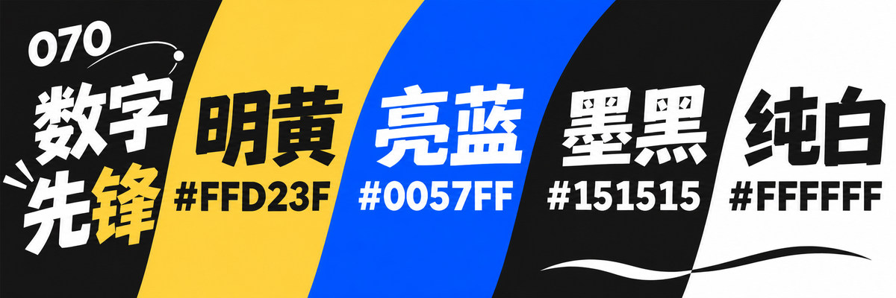

# 100 种文章封面配色组合

把下面这句话发给 Codex 安装：

> 帮我安装「文章封面配色」，只安装这个文件夹：https://github.com/WoYun520/gif-factory/tree/main/skills/article-cover-palette

装好后，直接发文章、标题或现有封面，说“用文章封面配色帮我做”。也可以用 `$article-cover-palette` 调用。

它帮你想清楚：这篇文章用什么颜色，标题写什么色，底色用什么色，哪里放一点强调色。需要图片时，再继续做成封面或配色卡。

## 先看几套

| 030 落日与海 | 070 数字先锋 |
| --- | --- |
|  |  |
| 橙、米色、钴蓝，适合鲜明但有温度的画面 | 黄、蓝、黑、白，适合醒目的工具与创意内容 |

[看全部100张色卡＋色号](references/color-cards.md) · [查用途和标题搭法](references/palette-table.md) · [下载CSV表格](references/palette-table.csv)

## 装进去有什么

| 内容 | 里面有什么 |
| --- | --- |
| 一张100套配色表 | 编号、名称、HEX、适用题材、情绪，以及标题字、底色、点缀色怎么分 |
| 一套选色规则 | 先看文章在讲什么、语气是什么，再挑颜色；已有配色合适也可以保留 |
| 两套出图模板 | 一套做文章封面，一套做正文里的窄横色卡；100张现成色卡也一起带上 |

100套是颜色选择。文章仍按教程、工具介绍、分析、经验、清单、故事情绪等少数用途来判断，同一类文章也可以选不同颜色。版式、字体和主体随内容来，不把所有封面都做成同一张图。

## 平时怎么用

1. 发文章正文、链接或标题。链接读不到时，补上正文；只有标题也能先给方案，会说明依据有限。
2. 助手推荐一套配色，必要时再给两套有明显区别的备选，说清为什么适合、颜色怎么分。
3. 你可以指定编号、自己给HEX，或提供照片、场景、字稿和字体要求。要直接出图也可以，不必每一步都确认。
4. 做好后检查标题、实际尺寸和手机上的阅读效果，再交付图片。

只问配色，就先给方案。要封面，就继续出封面。已有喜欢的构图时，可以只换色；已有颜色更合适时，也可以沿用。

## 可以直接这样说

> 读这篇文章，先推荐配色。说清楚底色、标题和点缀色，不急着画图。

> 用030“落日与海”，做一张5:2的文章封面。标题用我给的，不加人物。

> 保留这张封面的构图和字体，只换配色，照片里的肤色和产品颜色保留。

> 用我的颜色 #003049、#FDF0D5、#D62828 做封面，正文和标题我来提供。

> 取070“数字先锋”的现成色卡，再给我一段色号说明，放进文章正文。

文章封面未指定时从1500×600、5:2起步。正文色卡默认1200×400、3:1，适合夹在段落之间；平台或你有尺寸要求时按要求来。

## 需要装什么，会不会额外收费

看表和使用现成色卡不需要画图工具。查表、选色、准备提示词的脚本只需要Python 3，不需要Pillow或FFmpeg，也不调用付费API。

要生成新的封面或重画色卡，需要当前助手能使用生图或排版工具。本包不自带生图模型、账号或额度，生成费用按你使用的工具计算。安装成功与图片生成是两件事；脚本产出的提示词还需要继续交给画图工具。

可以和你已安装的其他封面Skill配合，按各自说明与许可使用；本包不包含它们的源码和风格库，也不要求必须装第三方Skill。

## 色号怎么看

实际用色以表中的HEX为准。现成色卡是AI视觉预览，不能把JPG里吸出来的颜色当成原始色值。需要精确纯色色块时，直接按HEX绘制。

标题和小字会分别检查对比，必要时补黑或白作字色。辅助字色不会算成新的配色，也不改原100套的色号。

[Skill指引](SKILL.md) · [选色规则](references/article-to-palette.md) · [脚本参数](references/script-usage.md) · [数据说明](references/data-notes.md) · [脚本与文档许可](LICENSE)
