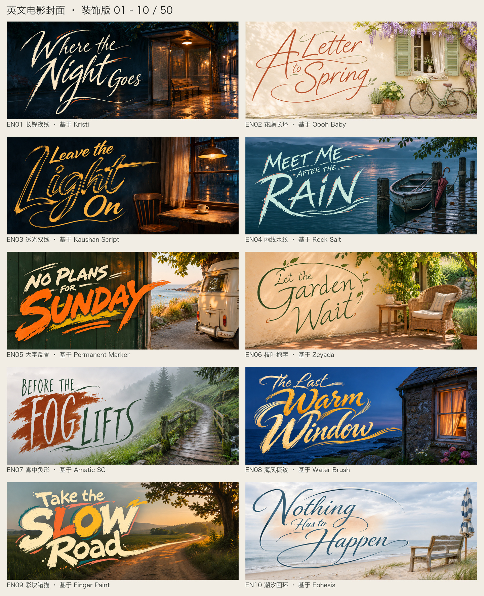
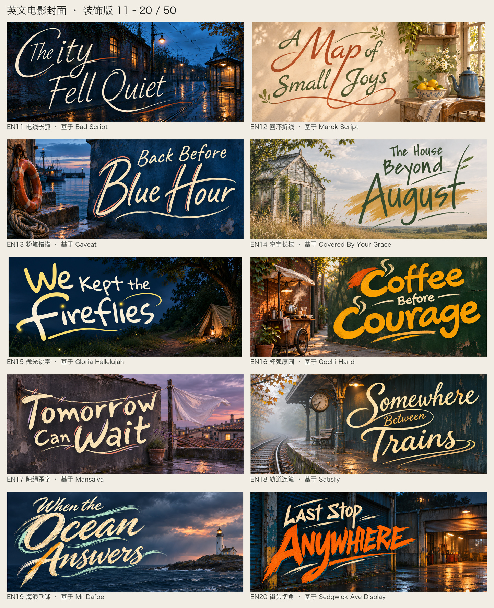
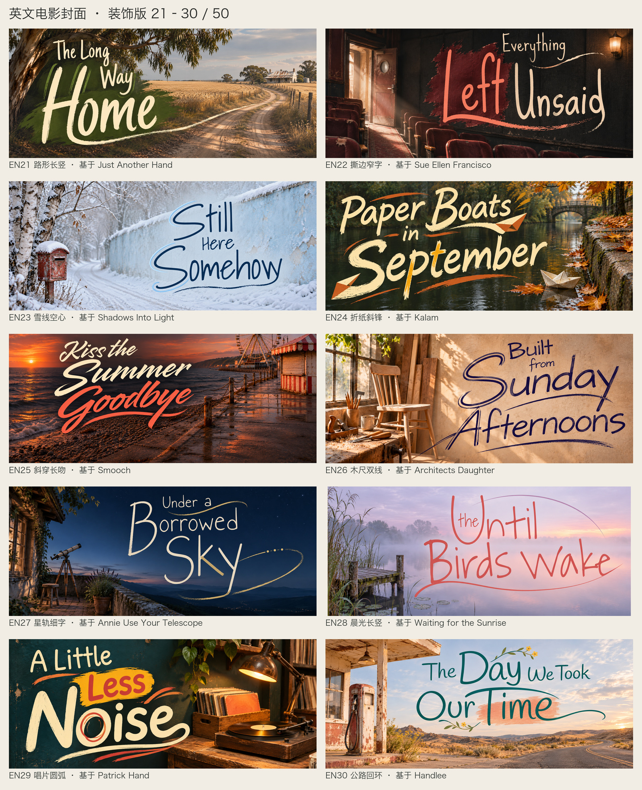
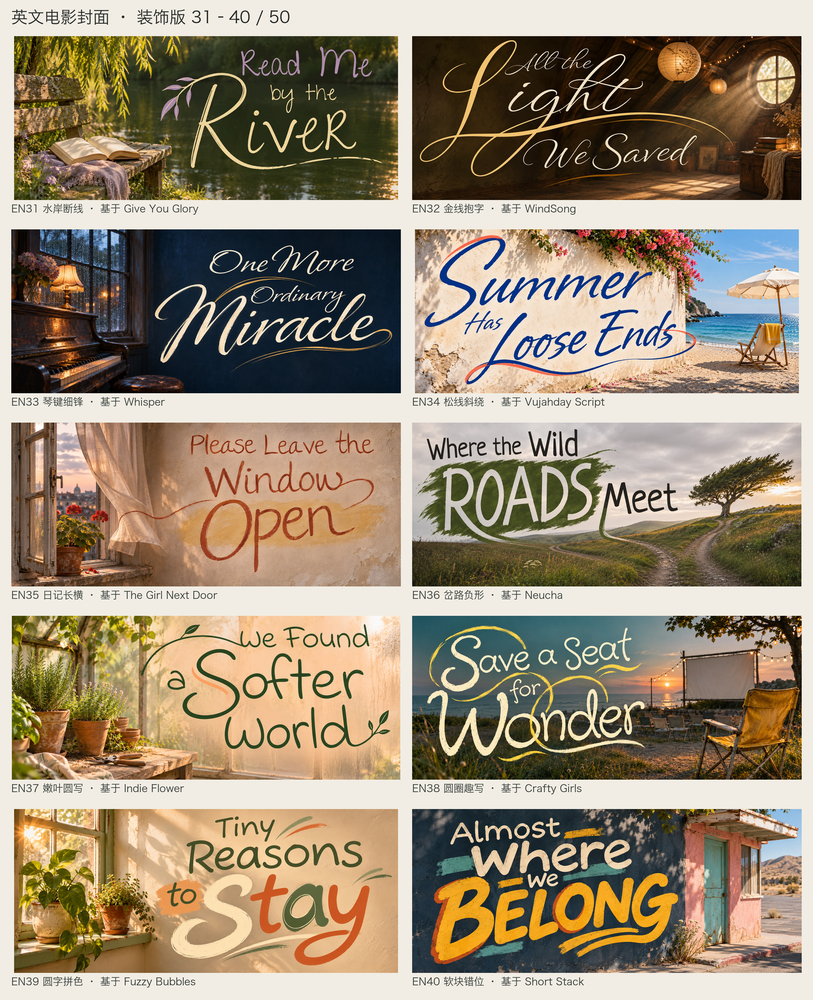
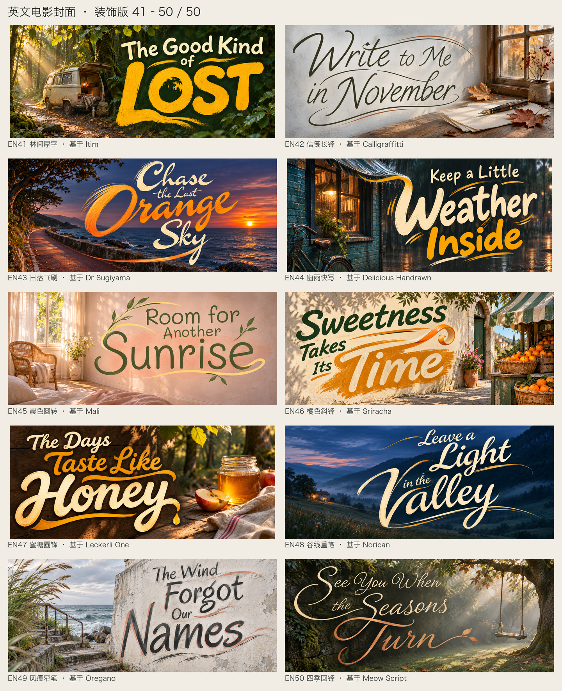

# 50款英文电影片头

每款都有一张独立封面、一份真实字体和字体样张。选 EN 编号，再给自己的英文片名。也可以直接提供照片、字体文件或已经写好的字稿。

中文用 F01–F50，英文用 EN01–EN50；R 是之前挑基础字体时的编号，沿用原编号。英文这50张是在基础字体上重新设计的装饰字稿，长笔锋、枝叶、水纹和色块属于片名设计。字体文件按各自授权提供。

## 怎么做

- 先打开选中款的完整封面和字体样张，保住字母骨架、粗细、连笔与空隙。细字保持轻细，厚圆字保持厚圆，不要统一改成同一种刷字。
- 需要严格保留字体字形时，用附带 TTF 排字；要装饰片名时，把字体样张和成图一起作为参考，按新单词重新安排主字、断行和长笔。
- 装饰从字母里长出来：大首字母抱住小词、收笔变成水线、局部描边或负形色块。长度跟着新单词走，避免另贴一堆图标。
- 文案逐词核对，保住词序和标点，忽略样张里的旧片名和字体标签。留出顶端、底端和两侧余量，尤其检查高竖、下伸笔和长收尾。
- 用户给了定稿字稿就直接排版融合；给了成品照片就按要求沿用，只补缺少的素材。
- 成组先做独立图，再每十张排成两列五行，图下标 EN 编号、装饰名和基础字体。保留独立原图、总览和实际提示词。

> 用 EN25 的写法做 “Letters from Summer”，保留粗细变化，放大首字母，让收笔连成一条海岸线。

## 按笔的感觉选

- **细笔与日记**：EN01、EN02、EN06、EN11、EN13、EN23、EN27、EN28、EN31、EN35、EN37、EN38、EN39、EN44、EN45
- **窄长与硬笔**：EN07、EN14、EN21、EN22、EN26、EN36、EN49
- **厚圆与趣写**：EN09、EN15、EN16、EN17、EN24、EN29、EN30、EN40、EN41
- **粗刷与街头**：EN03、EN04、EN05、EN20
- **连笔与长锋**：EN08、EN10、EN12、EN18、EN19、EN25、EN32、EN33、EN34、EN42、EN43、EN46、EN47、EN48、EN50

## EN01–EN10



| 编号与装饰 | 基础字体 | 示例片名 |
| --- | --- | --- |
| [EN01 长锋夜线](../assets/english-titles/frames/EN01.png) | R01 [Kristi](../assets/english-titles/fonts/Kristi/Kristi-Regular.ttf) | Where the Night Goes |
| [EN02 花藤长环](../assets/english-titles/frames/EN02.png) | R02 [Oooh Baby](../assets/english-titles/fonts/Oooh-Baby/OoohBaby-Regular.ttf) | A Letter to Spring |
| [EN03 透光双线](../assets/english-titles/frames/EN03.png) | R05 [Kaushan Script](../assets/english-titles/fonts/Kaushan-Script/KaushanScript-Regular.ttf) | Leave the Light On |
| [EN04 雨线水纹](../assets/english-titles/frames/EN04.png) | R06 [Rock Salt](../assets/english-titles/fonts/Rock-Salt/RockSalt-Regular.ttf) | Meet Me After the Rain |
| [EN05 大字反骨](../assets/english-titles/frames/EN05.png) | R07 [Permanent Marker](../assets/english-titles/fonts/Permanent-Marker/PermanentMarker-Regular.ttf) | No Plans for Sunday |
| [EN06 枝叶抱字](../assets/english-titles/frames/EN06.png) | R13 [Zeyada](../assets/english-titles/fonts/Zeyada/Zeyada.ttf) | Let the Garden Wait |
| [EN07 雾中负形](../assets/english-titles/frames/EN07.png) | R40 [Amatic SC](../assets/english-titles/fonts/Amatic-SC/AmaticSC-Regular.ttf) | Before the Fog Lifts |
| [EN08 海风梳纹](../assets/english-titles/frames/EN08.png) | R33 [Water Brush](../assets/english-titles/fonts/Water-Brush/WaterBrush-Regular.ttf) | The Last Warm Window |
| [EN09 彩块错描](../assets/english-titles/frames/EN09.png) | R44 [Finger Paint](../assets/english-titles/fonts/Finger-Paint/FingerPaint-Regular.ttf) | Take the Slow Road |
| [EN10 潮汐回环](../assets/english-titles/frames/EN10.png) | R59 [Ephesis](../assets/english-titles/fonts/Ephesis/Ephesis-Regular.ttf) | Nothing Has to Happen |

## EN11–EN20



| 编号与装饰 | 基础字体 | 示例片名 |
| --- | --- | --- |
| [EN11 电线长弧](../assets/english-titles/frames/EN11.png) | R14 [Bad Script](../assets/english-titles/fonts/Bad-Script/BadScript-Regular.ttf) | The City Fell Quiet |
| [EN12 回环折线](../assets/english-titles/frames/EN12.png) | R15 [Marck Script](../assets/english-titles/fonts/Marck-Script/MarckScript-Regular.ttf) | A Map of Small Joys |
| [EN13 粉笔错描](../assets/english-titles/frames/EN13.png) | R16 [Caveat](../assets/english-titles/fonts/Caveat/Caveat[wght].ttf) | Back Before Blue Hour |
| [EN14 窄字长枝](../assets/english-titles/frames/EN14.png) | R17 [Covered By Your Grace](../assets/english-titles/fonts/Covered-By-Your-Grace/CoveredByYourGrace.ttf) | The House Beyond August |
| [EN15 微光跳字](../assets/english-titles/frames/EN15.png) | R18 [Gloria Hallelujah](../assets/english-titles/fonts/Gloria-Hallelujah/GloriaHallelujah.ttf) | We Kept the Fireflies |
| [EN16 杯弧厚圆](../assets/english-titles/frames/EN16.png) | R19 [Gochi Hand](../assets/english-titles/fonts/Gochi-Hand/GochiHand-Regular.ttf) | Coffee Before Courage |
| [EN17 晾绳歪字](../assets/english-titles/frames/EN17.png) | R20 [Mansalva](../assets/english-titles/fonts/Mansalva/Mansalva-Regular.ttf) | Tomorrow Can Wait |
| [EN18 轨道连笔](../assets/english-titles/frames/EN18.png) | R21 [Satisfy](../assets/english-titles/fonts/Satisfy/Satisfy-Regular.ttf) | Somewhere Between Trains |
| [EN19 海浪飞锋](../assets/english-titles/frames/EN19.png) | R22 [Mr Dafoe](../assets/english-titles/fonts/Mr-Dafoe/MrDafoe-Regular.ttf) | When the Ocean Answers |
| [EN20 街头切角](../assets/english-titles/frames/EN20.png) | R24 [Sedgwick Ave Display](../assets/english-titles/fonts/Sedgwick-Ave-Display/SedgwickAveDisplay-Regular.ttf) | Last Stop Anywhere |

## EN21–EN30



| 编号与装饰 | 基础字体 | 示例片名 |
| --- | --- | --- |
| [EN21 路形长竖](../assets/english-titles/frames/EN21.png) | R29 [Just Another Hand](../assets/english-titles/fonts/Just-Another-Hand/JustAnotherHand-Regular.ttf) | The Long Way Home |
| [EN22 撕边窄字](../assets/english-titles/frames/EN22.png) | R30 [Sue Ellen Francisco](../assets/english-titles/fonts/Sue-Ellen-Francisco/SueEllenFrancisco-Regular.ttf) | Everything Left Unsaid |
| [EN23 雪线空心](../assets/english-titles/frames/EN23.png) | R31 [Shadows Into Light](../assets/english-titles/fonts/Shadows-Into-Light/ShadowsIntoLight.ttf) | Still Here Somehow |
| [EN24 折纸斜锋](../assets/english-titles/frames/EN24.png) | R32 [Kalam](../assets/english-titles/fonts/Kalam/Kalam-Regular.ttf) | Paper Boats in September |
| [EN25 斜穿长吻](../assets/english-titles/frames/EN25.png) | R34 [Smooch](../assets/english-titles/fonts/Smooch/Smooch-Regular.ttf) | Kiss the Summer Goodbye |
| [EN26 木尺双线](../assets/english-titles/frames/EN26.png) | R37 [Architects Daughter](../assets/english-titles/fonts/Architects-Daughter/ArchitectsDaughter-Regular.ttf) | Built from Sunday Afternoons |
| [EN27 星轨细字](../assets/english-titles/frames/EN27.png) | R38 [Annie Use Your Telescope](../assets/english-titles/fonts/Annie-Use-Your-Telescope/AnnieUseYourTelescope-Regular.ttf) | Under a Borrowed Sky |
| [EN28 晨光长竖](../assets/english-titles/frames/EN28.png) | R39 [Waiting for the Sunrise](../assets/english-titles/fonts/Waiting-for-the-Sunrise/WaitingfortheSunrise.ttf) | Until the Birds Wake |
| [EN29 唱片圆弧](../assets/english-titles/frames/EN29.png) | R41 [Patrick Hand](../assets/english-titles/fonts/Patrick-Hand/PatrickHand-Regular.ttf) | A Little Less Noise |
| [EN30 公路回环](../assets/english-titles/frames/EN30.png) | R42 [Handlee](../assets/english-titles/fonts/Handlee/Handlee-Regular.ttf) | The Day We Took Our Time |

## EN31–EN40



| 编号与装饰 | 基础字体 | 示例片名 |
| --- | --- | --- |
| [EN31 水岸断线](../assets/english-titles/frames/EN31.png) | R43 [Give You Glory](../assets/english-titles/fonts/Give-You-Glory/GiveYouGlory.ttf) | Read Me by the River |
| [EN32 金线抱字](../assets/english-titles/frames/EN32.png) | R45 [WindSong](../assets/english-titles/fonts/WindSong/WindSong-Regular.ttf) | All the Light We Saved |
| [EN33 琴键细锋](../assets/english-titles/frames/EN33.png) | R46 [Whisper](../assets/english-titles/fonts/Whisper/Whisper-Regular.ttf) | One More Ordinary Miracle |
| [EN34 松线斜绕](../assets/english-titles/frames/EN34.png) | R48 [Vujahday Script](../assets/english-titles/fonts/Vujahday-Script/VujahdayScript-Regular.ttf) | Summer Has Loose Ends |
| [EN35 日记长横](../assets/english-titles/frames/EN35.png) | R50 [The Girl Next Door](../assets/english-titles/fonts/The-Girl-Next-Door/TheGirlNextDoor.ttf) | Please Leave the Window Open |
| [EN36 岔路负形](../assets/english-titles/frames/EN36.png) | R51 [Neucha](../assets/english-titles/fonts/Neucha/Neucha.ttf) | Where the Wild Roads Meet |
| [EN37 嫩叶圆写](../assets/english-titles/frames/EN37.png) | R52 [Indie Flower](../assets/english-titles/fonts/Indie-Flower/IndieFlower-Regular.ttf) | We Found a Softer World |
| [EN38 圆圈趣写](../assets/english-titles/frames/EN38.png) | R53 [Crafty Girls](../assets/english-titles/fonts/Crafty-Girls/CraftyGirls-Regular.ttf) | Save a Seat for Wonder |
| [EN39 圆字拼色](../assets/english-titles/frames/EN39.png) | R54 [Fuzzy Bubbles](../assets/english-titles/fonts/Fuzzy-Bubbles/FuzzyBubbles-Regular.ttf) | Tiny Reasons to Stay |
| [EN40 软块错位](../assets/english-titles/frames/EN40.png) | R55 [Short Stack](../assets/english-titles/fonts/Short-Stack/ShortStack-Regular.ttf) | Almost Where We Belong |

## EN41–EN50



| 编号与装饰 | 基础字体 | 示例片名 |
| --- | --- | --- |
| [EN41 林间厚字](../assets/english-titles/frames/EN41.png) | R56 [Itim](../assets/english-titles/fonts/Itim/Itim-Regular.ttf) | The Good Kind of Lost |
| [EN42 信笺长锋](../assets/english-titles/frames/EN42.png) | R57 [Calligraffitti](../assets/english-titles/fonts/Calligraffitti/Calligraffitti-Regular.ttf) | Write to Me in November |
| [EN43 日落飞刷](../assets/english-titles/frames/EN43.png) | R60 [Dr Sugiyama](../assets/english-titles/fonts/Dr-Sugiyama/DrSugiyama-Regular.ttf) | Chase the Last Orange Sky |
| [EN44 窗雨快写](../assets/english-titles/frames/EN44.png) | R61 [Delicious Handrawn](../assets/english-titles/fonts/Delicious-Handrawn/DeliciousHandrawn-Regular.ttf) | Keep a Little Weather Inside |
| [EN45 晨色圆转](../assets/english-titles/frames/EN45.png) | R64 [Mali](../assets/english-titles/fonts/Mali/Mali-Regular.ttf) | Room for Another Sunrise |
| [EN46 橘色斜锋](../assets/english-titles/frames/EN46.png) | R65 [Sriracha](../assets/english-titles/fonts/Sriracha/Sriracha-Regular.ttf) | Sweetness Takes Its Time |
| [EN47 蜜糖圆锋](../assets/english-titles/frames/EN47.png) | R66 [Leckerli One](../assets/english-titles/fonts/Leckerli-One/LeckerliOne-Regular.ttf) | The Days Taste Like Honey |
| [EN48 谷线重笔](../assets/english-titles/frames/EN48.png) | R67 [Norican](../assets/english-titles/fonts/Norican/Norican-Regular.ttf) | Leave a Light in the Valley |
| [EN49 风痕窄笔](../assets/english-titles/frames/EN49.png) | R68 [Oregano](../assets/english-titles/fonts/Oregano/Oregano-Regular.ttf) | The Wind Forgot Our Names |
| [EN50 四季回锋](../assets/english-titles/frames/EN50.png) | R69 [Meow Script](../assets/english-titles/fonts/Meow-Script/MeowScript-Regular.ttf) | See You When the Seasons Turn |

## 准备输入

脚本只整理参考图和提示词，不调用生图 API。EN 和原 R 编号都能用，路径随 Skill 目录自动解析。

```bash
python3 scripts/prepare_english_title.py --style EN25 --title "Letters from Summer" --scene "日落海岸，右侧留一艘小船" --out title-input.json
```

有自己的照片可加 `--photo /path/to/photo.jpg`。将输出中的 `imagegen_args` 交给当前可用的生图工具。基础字体路径也会返回，方便直接排字。

这批有50张场景样图，EN23和EN25调整过裁断的笔画与文字。它们是字稿参考和实际提示词，没有做模型权重训练；换句后仍需检查拼写、字形和画面。

[中文50种写法](style-catalog.md) · [片头做法](film-title-frames.md) · [基础字体授权与来源](../assets/english-titles/source-notes.md)
