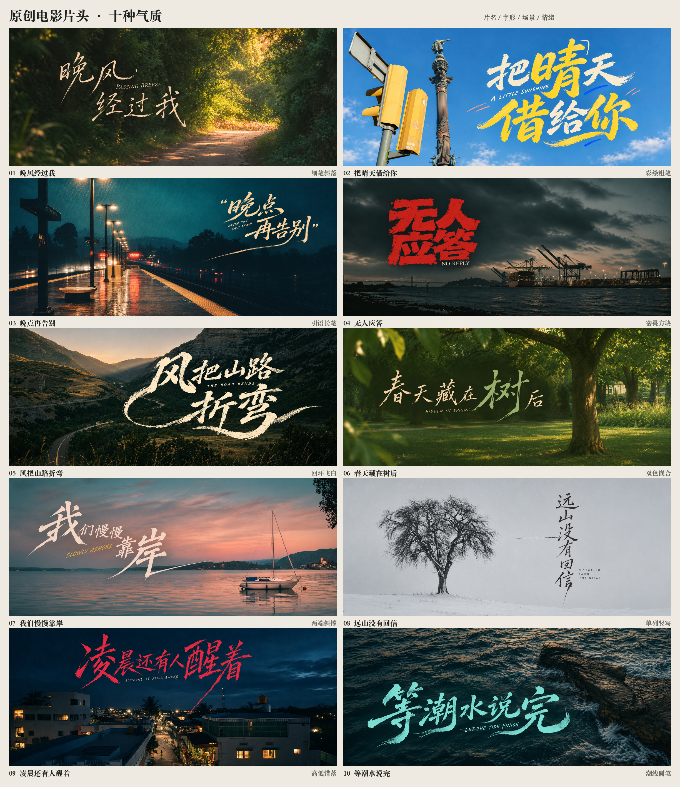

# 原创电影片头：字形与镜头一起设计

用于完整电影片头画面、成组原创片名设计，以及用户要求字、图和细节形成统一情绪的任务。独立字标和三联宣传图仍可单独制作；这份方法针对镜头里的完整横向片头。

## 从故事决定设计

1. **先定片子的气质。** 用一句具体关系说明这是什么故事，例如“雨停之前不想告别”“港口里没有收到的回应”。片名由这个关系生长。用户允许改句子、换照片时，可同时调整文案和选景；固定文案、字稿或照片时保留指定内容。
2. **片名、笔形、排法和镜头共同选。** 确定主字、读序、字组外轮廓及场景主物。雨夜可以用细密笔势和偏角留白，悬疑可以用密叠硬边，公路可以用回环干刷。换照片、换颜色本身不足以构成新的字形风格。
3. **从镜头的空间放字。** 先看路、树、船、建筑和光区在哪里，再选择字组落点与大小。保住叙事主体和视线方向，利用暗部、天空、水面等留白建立对比。字组无需每张居中、同样大或占满画面。长笔可以呼应道路、潮线、窗框等方向；遮挡、透视或半透明处理按具体镜头需要使用，保持读序。
4. **元素依附于字形。** 把物象变成现有笔画的走势、共用轮廓、字腔或收笔，例如以树的竖笔带出枝节，以潮字的收笔延伸水线。支持性的细线、点或短划从笔势和题意出发控制密度。检查去掉独立小图标后字标自身是否仍有设计关系；不用靠周围堆图案来补字形。
5. **中英文字作为一组。** 英文可嵌在两行错位、主字侧凹或长笔下形成的空隙；字号、笔性和颜色服从主片名。用户未要求英文时可省略。若英文会破坏字组轮廓，调整位置或省掉，不固定做一条居中副标题。
6. **共同完成色彩和质感。** 从镜头里取墨色或安排有意的冷暖反差，控制主色数量、飞白和笔缘纹理。照片保有摄影质感，笔触保有平面墨迹的清晰轮廓。颗粒、柔光和暗部服务于该片气质，避免所有题材用同一种滤镜。

用户要求十款不同风格时，逐款写清笔性、字组轮廓、主字、留白、色彩和镜头关系。既有字稿已选定时先核对对应图片，保持十款各自特征。表中的编号表示本组案例，不覆盖其他参考表里的同号排法。

## 十种基础关系与本轮片头

本组基础来自用户选定的《长风追光越海》十款对照字稿，按新片名重画。这里只是十款字稿及其使用示例，不是十套完整的可安装字体。新片头是制作示例，已检查画面与文字，不表示使用者已经逐款确认。



| 编号 | 基础字形与排布 | 片头示例 | 在镜头中的设计关系 |
| --- | --- | --- | --- |
| 01 | 细笔、针锋、短句斜落 | [晚风经过我](../assets/film-title-examples/01.png) | 杏色细笔落在林间暗部，字组斜向与转弯小路相应，亮处留给远方光口。 |
| 02 | 宽笔彩绘、主字抱两行 | [把晴天借给你](../assets/film-title-examples/02.png) | 晴字放大，黄白笔画与交通灯及蓝天共同配色，英文和少量短划穿插行间。 |
| 03 | 中等粗细、两行引语与长笔 | [晚点再告别](../assets/film-title-examples/03.png) | 字组位于雨夜站台右上，暖色墨与路灯相应，收笔沿透视方向回落。 |
| 04 | 钝角粗笔、密叠方块 | [无人应答](../assets/film-title-examples/04.png) | 红色两行字块压在冷色港口上空，重而紧的轮廓与远处机械结构呼应。 |
| 05 | 粗干刷、错层回环 | [风把山路折弯](../assets/film-title-examples/05.png) | 风和弯主导轮廓，回环由字内长出，实际山路仍能完整辨认。 |
| 06 | 细笔和大字嵌合、双墨色 | [春天藏在树后](../assets/film-title-examples/06.png) | 树字放大并换为灰绿，旁边的小字保持轻，实景树干承担另一侧重心。 |
| 07 | 两端大字斜撑、中间小字 | [我们慢慢靠岸](../assets/film-title-examples/07.png) | 我与岸撑开斜向字组，浅粉墨色取自暮色，岸的长收笔接近水面方向。 |
| 08 | 单列竖写、细锋留白 | [远山没有回信](../assets/film-title-examples/08.png) | 黑字与左侧孤树相对，细长竖列保留大块雪地和灰白天空。 |
| 09 | 高低错落、尖角长笔 | [凌晨还有人醒着](../assets/film-title-examples/09.png) | 凌与醒支撑字组，玫红对深蓝夜景，一处长笔接向街道方向。 |
| 10 | 饱满宽笔、横向嵌字 | [等潮水说完](../assets/film-title-examples/10.png) | 等与完撑外轮廓，海沫色笔画落于暗海面，英文贴进内凹，收笔回应潮线。 |

每款基础字稿保存在 [foundations](../assets/film-title-examples/foundations/)，用于以后延续这十种笔性；新任务根据新字重建骨架，不机械拉伸或搬用原来的字。

## 使用参考和照片

- 将参考分成三种角色：已选的自有字稿负责笔形与排布；照片负责镜头和场景；第三方电影参考帮助理解层级、笔触和画面气质。写明角色，避免模型混淆。
- 从第三方参考提炼疏密、比例、笔性和字与镜头的关系。新片名的骨架、主字、装饰和中英文落点要重新设计，公开案例包不夹带用户的聊天截图或第三方作品原图。
- 用户要求真实照片原样保留时，使用原图裁切、调色与独立字标叠合。允许重构时可用照片作图像生成参考；交付记录应说明实际用了参考、照片来源及 AI 重构，不能把重构结果标成原始实拍。
- 本组采用参考照片参与生成。照片来源见[来源与制作边界](../assets/film-title-examples/source-credits.md)，原始提示词、输入角色和本组修订见[生成记录](../assets/film-title-examples/prompts.json)。

## 画面检查与交付

放大逐字核对主片名、偏旁、标点及英文；缩小检查字组读序、场景主体、长笔落点和对比度。成组比较时检查笔性和外轮廓是否真的有区别，按需修正最相似的几款。

交付每张独立横幅，数量较多时另给总览与 ZIP。静帧标为静帧；需要动画时另完成运动与视频检查。保存确切提示词、输入角色、来源和实际输出尺寸。生成重跑可延续方向，不承诺像素一致；已保存的成品文件用于准确保留本轮结果。

仓库内的预览可从现有成品重建，不会重新生成艺术画面。从 Skill 目录运行：

```bash
python3 scripts/make_film_overview.py --out /tmp/film-title-overview.jpg
```

例如下次可以直接说：

> 沿用电影片头十款基础字稿，做六款新的横向片头。片名和镜头可以重新设计，分别有青春、夜行、海边、悬疑、山野与冬日气质。英文嵌在字间，物象从笔画与留白里长出来，保留每款不同的笔性。
