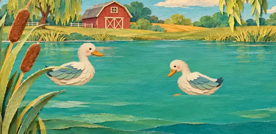

# 纸艺儿歌 MV

以实际使用的录音排戏。先听出一句由谁唱起、谁接、哪一个字开始合唱，剪出包含准备动作和下一镜开头的一段试演。把录音版本、成片起始时间和接唱词填进[儿歌分镜模板](../templates/song-plan.json)。换歌时重新标记这些位置。

## 让人物领唱，让同伴接住

| 乐句 | 领唱者 | 听者与镜头 |
| --- | --- | --- |
| 准备与起唱 | 在第一声前看向同伴，手抬到能看清的位置。在起唱词上给出手势。 | 听者先做自己的事，留一个能被打断的动作。 |
| 交给同伴 | 给完信号就放下手、收口或侧耳。身体停住一个乐句，视线留在接唱者身上。 | 听者先察觉，再在自己的词上开口。换地点时，让上镜的视线或动作引出下镜的第一反应。 |
| 再唱与收尾 | 按这一遍的关系改变手势。伙伴已经会接时，一个眼神就够。尾音出现后再收势。 | 合唱前可错开抬头、转身等准备动作，唱到共同的词再合拍。按故事选一个可读的收尾动作。 |

**人形角色试姿态。** 先在最终构图里并排看放手、抬手给拍、收势三个完整轮廓。农夫抬手时，前臂作为独立纸片绕肘转，袖口与上臂留出重叠，帽檐和靴底锚在各自的位置。看最大抬手角度时手指是否完整，收手时袖口是否露缝，站定时脚及接触阴影是否滑动。手势清楚后再加眨眼、口型。换成人物点头或其他角色时，选择它最容易读懂的轮廓变化。

**在成片里看。** 《农场接唱会》开头农夫抬手后留给小鸡回应，果园由落果引出火鸡低头，再由农夫给拍，院子里动物依次抬头，尾音后鞠躬。池塘段经用户认可，完整版也获得正向反馈。下面是从成片截取的静音预览，供判断谁在发起、谁听见了。音乐落点用实际录音核对。



## 从试段扩到整片

1. 按[接唱与回应](action-review.md#接唱与回应)先静音遮字幕看，再开声核对。记录实际看到的姿态、听到的接唱词和时间。走位与道具相交时，同时走[遮挡检查](action-review.md#角色经过道具)。
2. 用户选定要沿用的试段后，在模板的 `approved_ranges` 中记下母版、起始帧和帧数，例如 `{"source":"approved.mp4","reference_start":669,"candidate_start":669,"frames":192}`。将这一段放回整片时沿用相同的角色姿态、切点和音画相对时间。若改的是相邻镜头，连同接缝两侧一起试听。
3. 若约定原样保留画面，可在相同帧率、尺寸、色彩和字幕条件下用下面的命令比较两份母版。帧号从零计。示例是 24 fps 的 27.875 秒起，共 192 帧。交付版若有二次压缩，取编码前母版比对；只有压缩片时对照回看片段并记录判断。此检查只比较画面，片段首尾的声音落点仍需试听。

```sh
python3 scripts/compare_approved_range.py approved.mp4 full.mp4 --reference-start 669 --candidate-start 669 --frames 192
```
