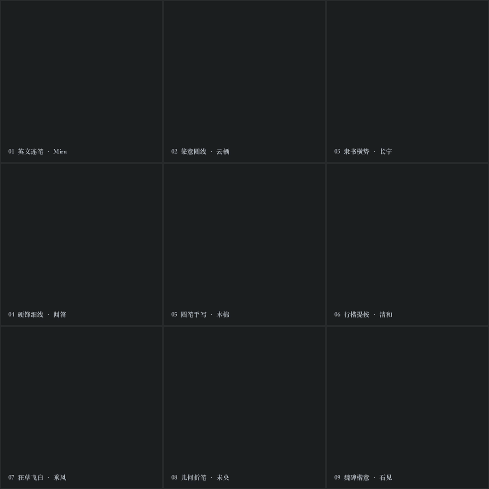

# 动态签名的四种风格

先看动图，选喜欢的效果，再换成你的名字、字体和颜色。可以用英文连笔、草书、行书、瘦金体，也可以直接提供自己的字稿。几种效果能搭配，比如「瘦金体＋乐器融字＋墨迹聚合」。

[纯文字连笔](#word-only) · [意象融字](#motif-fusion) · [乐器融字](#instrument-fusion) · [墨迹聚合](#ink-assembly)

## 纯文字连笔

名字沿原笔迹写出来，靠笔画的粗细、连笔、回钩和收锋体现个性。可以保持原色，也可以配单色或渐变色。

这是 [@likka-ailive](https://github.com/likka-ailive) 提交的新效果。目前可以先看动图，相关功能还没正式合进仓库，进度见[这次提交](https://github.com/WoYun520/gif-factory/pull/2)。图里的七种颜色，都是同一种签名的配色选择。

做这款时，把名字本身写出特点就够了。连笔顺着原字迹写，独立的小点也要保留，最后的长尾可以慢慢收住。已有字稿就沿用字稿，保留原来的细线和柔和边缘。

> 给“Likka”做一款纯文字连笔签名，保持名字完整，试一下青蓝到浅黄的渐变，末锋慢下来。

## 意象融字

把鸟、月亮、植物、浪花等融进名字的笔画、轮廓或留白，让人能同时看出名字与意象。

先想好图案怎么藏进字里。比如鸟的翅膀可以成为一笔，月亮可以成为字母的弧线。上方另有一笔时，先写上方，停一下，再写名字，最后收尾放慢。已经选好的字稿和节奏继续沿用。

> 给“Levi”做一款乌鸦意象签名，鸟的轮廓融进字母，配雾白到淡紫。

[设计方法](design.md) · [中英文案例](examples.md) · [中文与三字布局](chinese.md)

## 乐器融字

琴弦、笛身、音孔、琴框成为字的一部分，同时保留名字的辨识度。

告诉 Codex 想要哪种乐器、哪种字体，它来设计乐器和哪一笔接在一起。换字体时保留字本身的特点，细的地方仍然细，圆的地方仍然圆。可以沿笔迹写出，也可以搭配下面的墨迹聚合。

> 给“闻笛”做一款瘦金体感觉的签名，把竹笛管身和音孔融进笔画，保留细锋和慢收笔。

[乐器入字与两组案例](instrument-semantic.md) · [九种字体与自定义](multifont.md) · [字体适配](font-adaptation.md)

## 墨迹聚合

从字稿里切出保有笔画和颜色的墨迹碎片，让它们移动、转动，再回到原位凝成字。可以与意象融字、乐器融字搭配。

先把字写好，再选哪些笔画变成碎片。可以前半段照常书写，后半段慢慢聚拢，最后把长尾写完。聚拢后要回到原来的字形，名字完整，颜色也和选好的字稿一致。

> 用这张“乘风”的狂草字稿，把后半部分做成墨迹聚合，保留前面的快写和最后的慢收锋。

[渲染配置](rendering.md) · [现成墨迹聚合配置](../assets/adaptive/Woyunjian/ink-fragments.json)

## 字体、配色与交付

字体决定笔画样子，配色决定底色与墨色，动效决定怎么出现。三者按用户选择组合，换颜色时保留已选字稿与动画节奏。

已有字稿可以保留原来的颜色。纯文字示例里的七种新配色，目前先看动图，等相关功能正式合进仓库后再使用。做完要看名字是否完整、细线和小点是否保留、收尾是否自然、循环是否顺畅。最后给你 MP4、循环 GIF，以及需要的字稿和参数文件。
