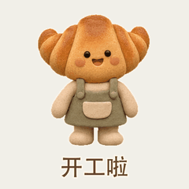
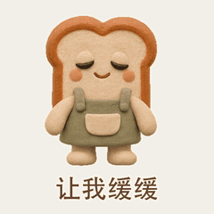
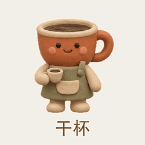
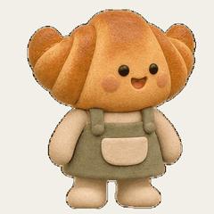

# 粘土吉祥物

[返回风格库](../README.md) · [查看原尺寸案例](../../examples/clay-bakery/01-croissant.gif)

## 动态案例 · 4 张

<table>
<tr>
<td width="33%" valign="top"> 牛角包</td>
<td width="33%" valign="top"> 吐司</td>
<td width="33%" valign="top"> 咖啡</td>
</tr>
<tr>
<td width="33%" valign="top"> 拉开纸片</td>
</tr>
</table>

## 长什么样

柔和体积、哑光粘土、豆豆眼与统一光线。

## 怎么动

连续姿态配合微小回弹，让材质和角色性格保留下来。

适合：虚构店铺、品牌 IP、产品搭档。当前参考尺寸与节奏：512×512，按动作设定。这些是该系列默认值，用户指定尺寸或时长时按请求处理。

## 制作入口

先沿用已认可的角色、画风与动作。阅读[外观与素材要求](../../references/appearance.md#illustration)和[实际制作流程](../../references/keyframes.md)；不要套用另一种画风或用途的导出默认值。

粘土视觉不等于已经建立三维模型；纸片拼贴场景也不用把角色改成纸片。

新角色、新动作先做小样；技术检查和用户认可分开记录。高清不等于动作完整，关键状态切换也不等于持续表演。

## 可以直接这样说

> 设计一只虚构面包店的粘土牛角包吉祥物，先做一张挥手 GIF，保持哑光材质、豆豆眼和统一光线。

## 案例与交付

[现有案例与版本记录](../../GALLERY.md#表情包展厅)。独立 GIF 是最终交付，缩小预览不替代原尺寸文件。检查解码后的实际时长、循环接缝、人物与文字；批量总览按 GIF 的真实帧延时采样。
