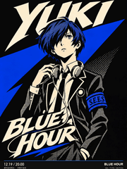

# 漫画印刷整体融合

[返回风格库](../README.md) · [查看原尺寸案例](../../examples/dynamic-posters/p5-integrated/04-yuki.gif)

## 长什么样

限定色、墨线、网点、斜切负空间与定制字形统一设计。

## 怎么动

人物从平静切到登场／爆发，整幅关键状态与大字一起变化。

适合：角色宣传、活动主视觉、演出海报。当前参考尺寸与节奏：720×960，6 秒循环。这些是该系列默认值，用户指定尺寸或时长时按请求处理。

## 制作入口

先沿用已认可的角色、画风与动作。阅读[外观与素材要求](../../references/dynamic-posters.md)和[实际制作流程](../../references/dynamic-posters.md)；不要套用另一种画风或用途的导出默认值。

不要在未修改的彩色图上硬贴字。当前九张是两幅完整海报的光栅切换，不是逐字独立变形。

新角色、新动作先做小样；技术检查和用户认可分开记录。高清不等于动作完整，关键状态切换也不等于持续表演。

## 可以直接这样说

> 做一张 P5 式漫画印刷整体融合 GIF 海报，人物、背景和文字一起重绘，保留角色主色，头发和手臂与标题有前后遮挡，6 秒循环。

## 案例与交付

[现有案例与版本记录](../../examples/dynamic-posters/p5-integrated/README.md)。独立 GIF 是最终交付，缩小预览不替代原尺寸文件。检查解码后的实际时长、循环接缝、人物与文字；批量总览按 GIF 的真实帧延时采样。
