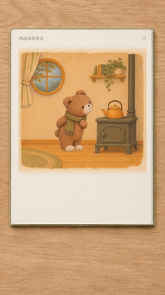

# 紧凑动态绘本

[返回风格库](../README.md) · [看完整案例](../../examples/storybooks/tea-party/README.md) · [独立 Skill](../../skills/compact-storybook/SKILL.md)

让一张插画把一件事做完：递一封信、放飞纸鸟、接住礼物、合上书。动作之后短暂停留，再翻到下一页。适合绘本故事、角色小剧场、品牌故事和插画叙事。

<table>
<tr>
<td align="center" valign="top"><strong>横屏 · 左字右图</strong> </td>
<td align="center" valign="top"><strong>竖屏 · 图上字下</strong> </td>
</tr>
</table>

默认固定构图、实际6fps、每页约3秒；可以独立输出，也可以放进翻书外框。这里的网页预览循环播放，正式成片动作只做一遍。低帧不等于像素化，用户指定的画风照样保留。

## 什么图适合

- 角色轮廓、脸和服装清楚，动作空间足够的插画。
- 能拆成“起始 → 一个动作 → 结果”的画面。
- 背景能与角色、道具分开，手和桌面等接触位置看得清。

拥挤群像、遮挡严重、只剩小脸或需要复杂连续运镜的图，先整理构图或做一页试样。照片转插画需要用户明确选择，不直接套真人美颜路线。

## 怎么开始

> 使用 $pixel-gif-sticker-pack，选择“紧凑动态绘本”，把这个故事做成固定画面的小动画。先做一页约3秒、6帧的小样，动作做完就停，不要镜头组。

也可单独安装仓库 `skills/compact-storybook` 文件夹，用 `$compact-storybook` 调用。完整规则、提示词和检查脚本都在里面。HyperFrames用于组合和导出时，还需要当前环境的HyperFrames工具与对应说明；这份Skill不附赠图片生成或渲染服务。

## 当前已验证

《风送来的茶会》当前成片为12页、54秒真实书本版，含快速书写、沙沙声和配乐；书本与书写样片已获用户认可。不是所有故事都固定做12页，也不把短动作拉长凑两分钟。画风和故事可以更换，新组合先看一页样片。

## 现在也能做成真实书本

横屏把动画放进摊开的书：左字右图、正俯拍，保留薄纸、书脊和桌面质感。竖屏用图上字下的白框书页，方便手机看。两版共享故事素材，分别排版。

先把书和背景的静态质感确认好，再叠回原动画；不是给方框换个颜色、撒点噪点。配乐可用 Suno、Gemini 这类工具单独制作轻柔摇篮曲，导出后再加入视频；也能用自己已有的音乐。旁白按需另外做。

[稳定版制作规则](../../skills/compact-storybook/SKILL.md) · [书本、排版与音乐](../../skills/compact-storybook/references/book-and-sound.md)

正文可以在翻页落稳后快速写上纸面，配轻轻的沙沙声；写完就停，留下阅读时间。标题和页码保持静态。[书写效果规则](../../skills/compact-storybook/references/handwriting.md)。

[观看54秒真实书本书写完整版](../../examples/storybooks/tea-party/realbook-writing.mp4)。12页、6fps，含配乐与15组正文书写。

[观看54秒竖屏书写完整版](../../examples/storybooks/tea-party/portrait-writing.mp4)。1080×1920，与横屏共用动作、书写节拍、配乐和沙沙声；独立重排，保留四周白框。
