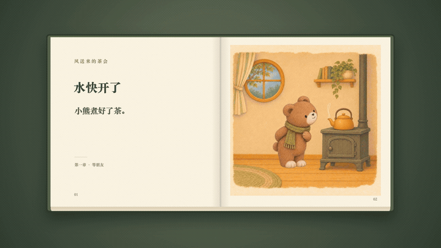

# 紧凑动态绘本

[返回风格库](../README.md) · [看完整案例](../../examples/storybooks/tea-party/README.md) · [独立 Skill](../../skills/compact-storybook/SKILL.md)

让一张插画把一件事做完：递一封信、放飞纸鸟、接住礼物、合上书。动作之后短暂停留，再翻到下一页。适合绘本故事、角色小剧场、品牌故事和插画叙事。

默认固定构图、实际6fps、每页约3秒；可以独立输出，也可以放进翻书外框。这里的网页预览循环播放，正式成片动作只做一遍。低帧不等于像素化，用户指定的画风照样保留。

## 什么图适合

- 角色轮廓、脸和服装清楚，动作空间足够的插画。
- 能拆成“起始 → 一个动作 → 结果”的画面。
- 背景能与角色、道具分开，手和桌面等接触位置看得清。

拥挤群像、遮挡严重、只剩小脸或需要复杂连续运镜的图，先整理构图或做一页试样。照片转插画需要用户明确选择，不直接套真人美颜路线。

## 怎么开始

> 使用 $pixel-gif-sticker-pack，选择“紧凑动态绘本”，把这个故事做成固定画面的小动画。先做一页约3秒、6帧的小样，动作做完就停，不要镜头组。

也可单独安装仓库 `skills/compact-storybook` 文件夹，用 `$compact-storybook` 调用。完整规则、提示词和检查脚本都在里面。HyperFrames用于组合和导出时，还需要当前环境的HyperFrames工具与对应说明；这份Skill不附赠图片生成或渲染服务。

## 当前已验证

《风送来的茶会》12页、4章、41.5秒无声翻书版已获用户认可。不是所有故事都固定做12页，也不把短动作拉长凑两分钟。画风和故事可以更换，新组合先看一页样片。
