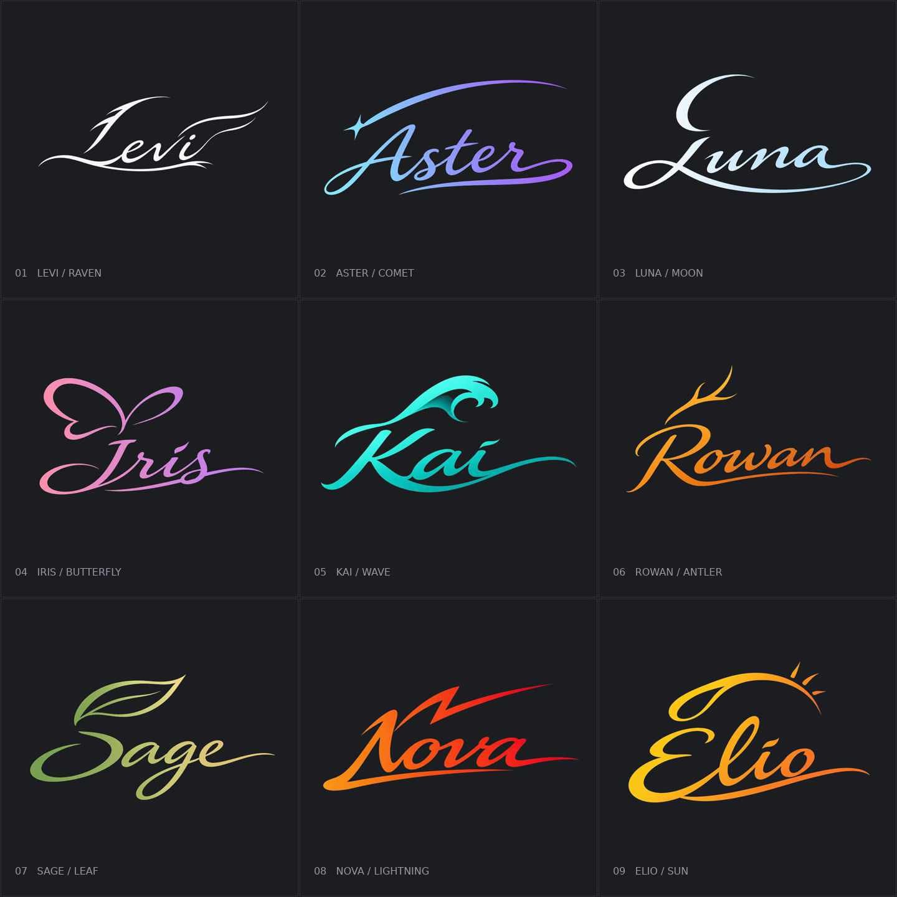
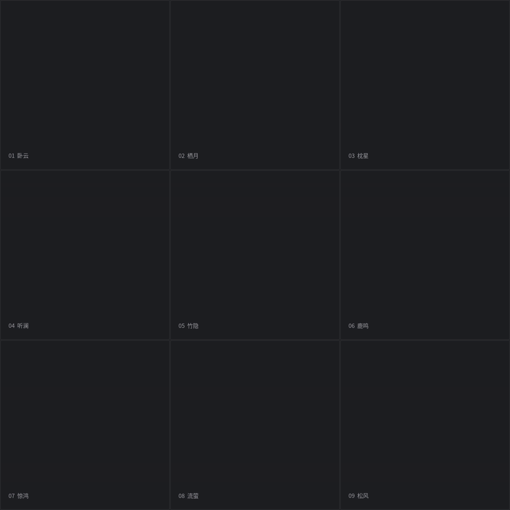

# 动态艺术签名

[返回风格库](../README.md) · [九宫格 GIF](../../skills/dynamic-art-signature/assets/media/nine-grid.gif)

## 长什么样

名字、物体和渐变色共用字形轮廓；保留可读文字、手写提按、粗细变化和干净收锋。上方笔势与下方字身物理分离。九款包含乌鸦、彗星、月弧、蝶翼、海浪、鹿角、叶脉、闪电与日轮；换物体时重新设计笔势，不只是替换名字。

## 怎么动

上方一笔快速划出，停约一秒，下方快写后逐渐收锋。未写区域空白；不加轻震、尾尖回弹或金属光效。默认独立 MP4 960×640、60fps，GIF 25fps，4秒循环。已有基准媒体保留当次接受版本，不承诺每款恢复了精确真实书写顺序。

## 制作入口

阅读[制作流程](../../references/dynamic-signatures.md)及[独立 Skill](../../skills/dynamic-art-signature/SKILL.md)。按实际组件分层，检查上笔独占阶段与字身转尾迹位置；不要用全图降透明度或宽大遮罩制造底印和重复落笔。

## 可以直接这样说

> 使用 $pixel-gif-sticker-pack，做一款 Levi＋乌鸦＋白黑渐变的动态艺术签名；物体融进字形，两笔分开，停约1秒，最后像书法一样缓慢收锋。

[九款独立媒体与原图](../../examples/dynamic-signatures/README.md)

## 中文草书与三字签名

默认草书，明确要求行书时保留完整结构并减少连笔。中文也保留可见意象，上方图形与下方字身物理分离；三字重新安排宽度、重心和末字长锋，沿用两组视觉笔势，不挤字或丢字。

[三字「卧云间」](../../skills/dynamic-art-signature/assets/media/chinese/Woyunjian.gif) · [中文规则与可复现案例](../../skills/dynamic-art-signature/references/chinese.md)
