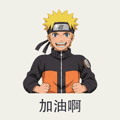

# 插画角色动作

[返回风格库](../README.md) · [查看原尺寸案例](../../examples/mixed-actions/02-二次元/005.gif)

## 长什么样

保留二次元、Q 版或已有插画的脸、服装和线条。

## 怎么动

用连续关键姿态让角色完整做动作，带动头发和衣服。

适合：动漫角色、角色动作表情。当前参考尺寸与节奏：512×512，按动作设定循环。这些是该系列默认值，用户指定尺寸或时长时按请求处理。

## 制作入口

先沿用已认可的角色、画风与动作。阅读[外观与素材要求](../../references/appearance.md#illustration)和[实际制作流程](../../references/keyframes.md)；不要套用另一种画风或用途的导出默认值。

检查衣服结构、脸和手的连续性。阿尼亚／哆啦A梦修正版仍按各自状态记录，不自动提升为成功模板。

新角色、新动作先做小样；技术检查和用户认可分开记录。高清不等于动作完整，关键状态切换也不等于持续表演。

## 可以直接这样说

> 保留这张插画画风，做一张完整打气动作 GIF，头和上半身一起动，先检查脸和手。

## 案例与交付

[现有案例与版本记录](../../GALLERY.md#表情包展厅)。独立 GIF 是最终交付，缩小预览不替代原尺寸文件。检查解码后的实际时长、循环接缝、人物与文字；批量总览按 GIF 的真实帧延时采样。
