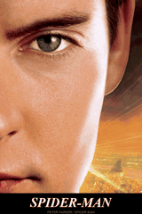
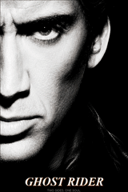
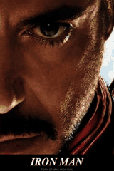
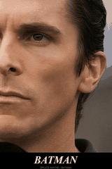
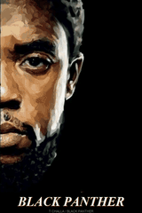
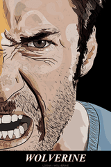
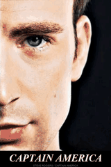
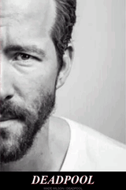

# 双状态光栅卡

[返回风格库](../README.md) · [查看原尺寸案例](../../examples/lenticular-cards/01-spider-man.gif)

## 动态案例 · 9 张

<table>
<tr>
<td width="33%" valign="top"> 蜘蛛侠</td>
<td width="33%" valign="top"> 恶灵骑士</td>
<td width="33%" valign="top"> 毒液</td>
</tr>
<tr>
<td width="33%" valign="top"> 钢铁侠</td>
<td width="33%" valign="top"> 蝙蝠侠</td>
<td width="33%" valign="top"> 黑豹</td>
</tr>
<tr>
<td width="33%" valign="top"> 金刚狼</td>
<td width="33%" valign="top"> 美国队长</td>
<td width="33%" valign="top"> 死侍</td>
</tr>
</table>

## 长什么样

同一构图在人物／面罩、日常／变身等两种形象间变化。

## 怎么动

两状态停留，用纵向细条来回切换，卡片标题通常固定。

适合：收藏卡、人物双身份、产品两配色。当前参考尺寸与节奏：480×720，6 秒循环。这些是该系列默认值，用户指定尺寸或时长时按请求处理。

## 制作入口

先沿用已认可的角色、画风与动作。阅读[外观与素材要求](../../references/lenticular.md)和[实际制作流程](../../references/lenticular.md)；不要套用另一种画风或用途的导出默认值。

先检查角度、眼线、下巴和肩线，不用黑边、拉宽脸或拼接背景掩盖错配。

新角色、新动作先做小样；技术检查和用户认可分开记录。高清不等于动作完整，关键状态切换也不等于持续表演。

## 可以直接这样说

> 用这两张配得上的图做一张双状态光栅 GIF 卡，480×720，6 秒循环，标题固定，先检查眼睛和下巴能否对上。

## 案例与交付

[现有案例与版本记录](../../GALLERY.md#电子光栅卡展厅)。独立 GIF 是最终交付，缩小预览不替代原尺寸文件。检查解码后的实际时长、循环接缝、人物与文字；批量总览按 GIF 的真实帧延时采样。
