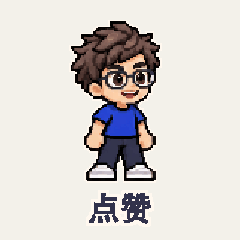
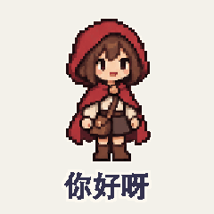

# 像素完整动作

[返回风格库](../README.md) · [查看原尺寸案例](../../examples/pixel-actions/boy/01.gif)

## 动态案例 · 8 张

<table>
<tr>
<td width="33%" valign="top"> 眼镜男孩·冲鸭</td>
<td width="33%" valign="top"> 眼镜男孩·点赞</td>
<td width="33%" valign="top"> 红帽女孩·你好呀</td>
</tr>
<tr>
<td width="33%" valign="top"> 红帽女孩·谢谢你</td>
<td width="33%" valign="top"> 太空猫·起飞啦</td>
<td width="33%" valign="top"> 太空猫·收到</td>
</tr>
<tr>
<td width="33%" valign="top"> 小企鹅·开心扭扭</td>
<td width="33%" valign="top"> 小企鹅·谢谢你</td>
</tr>
</table>

## 长什么样

像素边缘清楚，人物有动作前后的姿态变化。

## 怎么动

头、身体、手一起完成挥手、点赞、欢呼等动作。

适合：游戏感角色、动作表情包。当前参考尺寸与节奏：320×320，时长随动作。这些是该系列默认值，用户指定尺寸或时长时按请求处理。

## 制作入口

先沿用已认可的角色、画风与动作。阅读[外观与素材要求](../../references/appearance.md#pixel)和[实际制作流程](../../references/pixel-actions.md)；不要套用另一种画风或用途的导出默认值。

保留最近邻采样，不能拿只转动手臂的静止身体冒充完整动作。

新角色、新动作先做小样；技术检查和用户认可分开记录。高清不等于动作完整，关键状态切换也不等于持续表演。

## 可以直接这样说

> 做一张像素完整动作 GIF，让角色先蓄力再举拳欢呼，头、身体和手一起配合，保留像素边缘。

## 案例与交付

[现有案例与版本记录](../../GALLERY.md#表情包展厅)。独立 GIF 是最终交付，缩小预览不替代原尺寸文件。检查解码后的实际时长、循环接缝、人物与文字；批量总览按 GIF 的真实帧延时采样。
