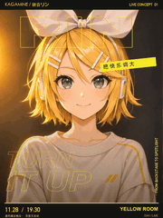
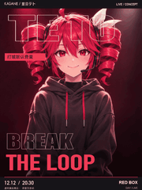
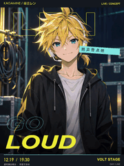

# 人物与字体联动

[返回风格库](../README.md) · [查看原尺寸案例](../../examples/dynamic-posters/type-linked/01-rin.gif)

## 动态案例 · 4 张

<table>
<tr>
<td width="33%" valign="top"> 镜音铃</td>
<td width="33%" valign="top"> 流歌</td>
<td width="33%" valign="top"> Teto</td>
</tr>
<tr>
<td width="33%" valign="top"> 镜音连</td>
</tr>
</table>

## 长什么样

保留原插画，字的大小、字距、倾斜和虚实与人物一起变化。

## 怎么动

人物两状态切换，独立文字图层分档展开，日期场地固定。

适合：演出预告、人物宣传、换装展示。当前参考尺寸与节奏：720×960，6 秒循环。这些是该系列默认值，用户指定尺寸或时长时按请求处理。

## 制作入口

先沿用已认可的角色、画风与动作。阅读[外观与素材要求](../../references/dynamic-posters.md)和[实际制作流程](../../references/dynamic-posters.md)；不要套用另一种画风或用途的导出默认值。

字不要挡眼睛和招牌道具；不要只换衣服。此案例有独立文字图层，完整融合图中文字则未必可拆开。

新角色、新动作先做小样；技术检查和用户认可分开记录。高清不等于动作完整，关键状态切换也不等于持续表演。

## 可以直接这样说

> 保留这张插画，做人物和字体联动海报：日常切到开唱，标题从收紧轮廓字撑成大实心字，日期场地固定，6 秒循环。

## 案例与交付

[现有案例与版本记录](../../examples/dynamic-posters/type-linked/README.md)。独立 GIF 是最终交付，缩小预览不替代原尺寸文件。检查解码后的实际时长、循环接缝、人物与文字；批量总览按 GIF 的真实帧延时采样。
